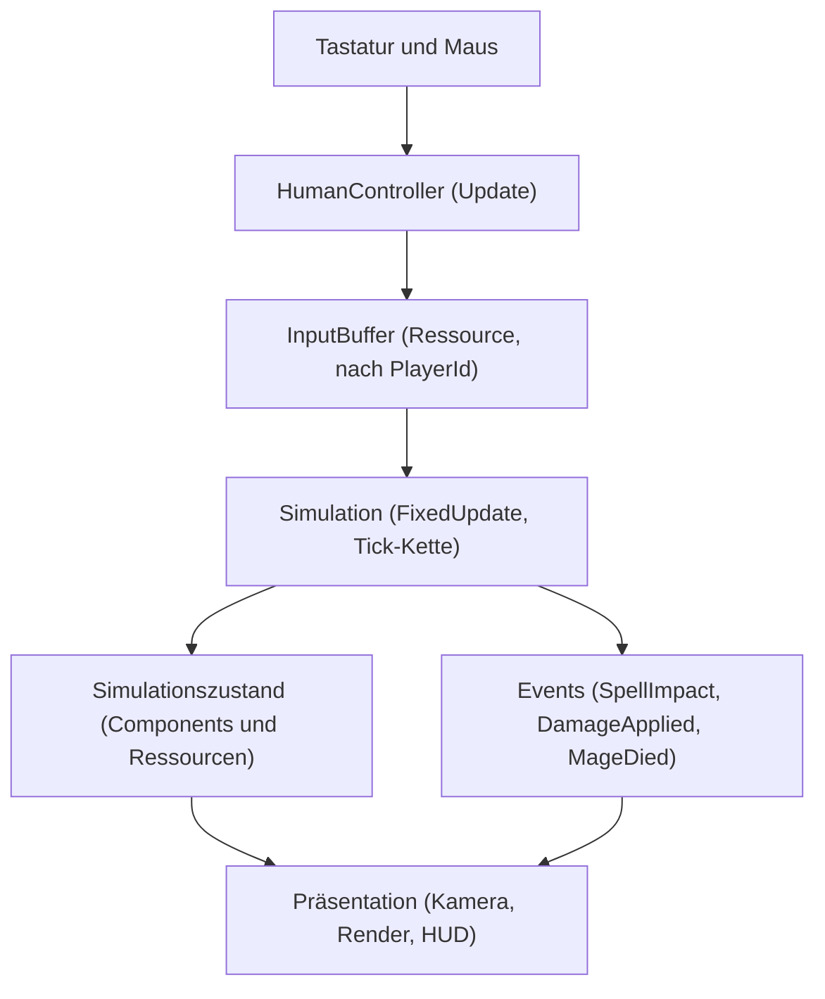
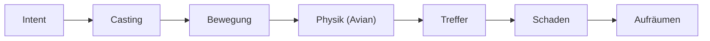
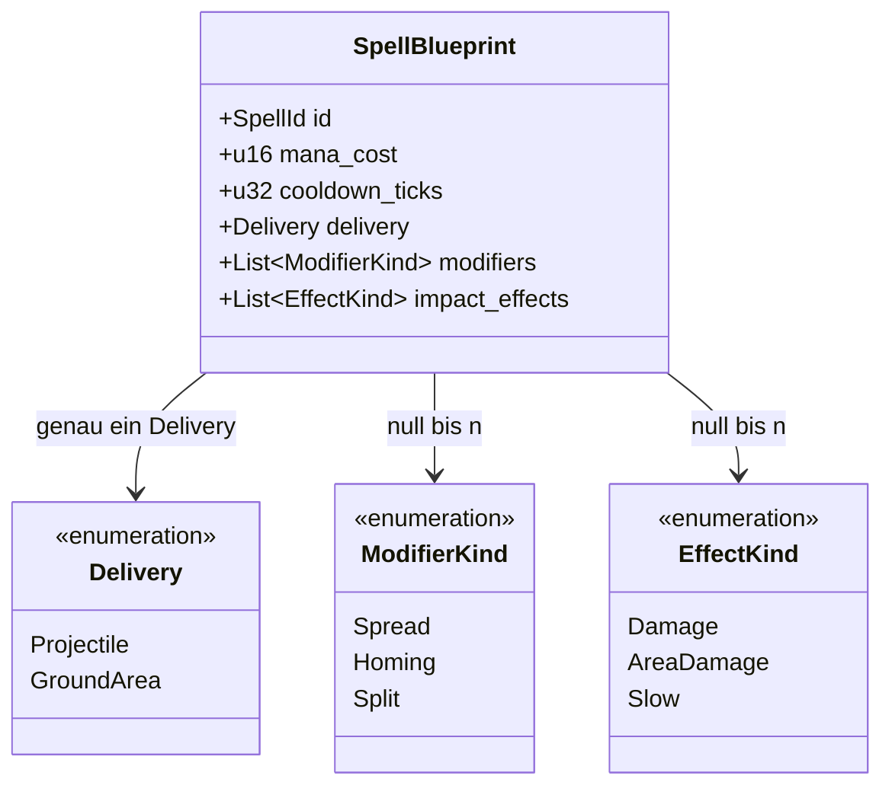

# Mage Game — Vault Home

**Mage Game** ist ein stilisiertes 3D-Arena-Duellspiel in Rust (Bevy 0.20, Avian 0.8). Spieler steuern Magier mit freier 3D-Bewegung, Third-Person-Zielen und modularen, anpassbaren Zaubern; später kommen PvP mit Rollback-Netcode und KI-Gegner. Dieser Vault dokumentiert den fundamentalen Prototyp: Spezifikation, Architektur, Entscheidungen, Teststrategie und offene Probleme, eine Seite pro Thema.

> Status — Vault v1.1 (2026-11-14): Spezifikation nach Review überarbeitet; P-001 und P-002 sind entschieden, offen bleiben P-003 bis P-005. Implementierung noch nicht begonnen. Nächster Schritt: Milestone 1 — Walking Skeleton.

> Aufbau — dieser Vault folgt den Moonkale-Konventionen: eine Inhaltskarte hier, pro Thema eine Seite, Entscheidungen als nummerierte ADRs, Probleme als P-Log, Pläne als Milestones. Die Zuordnungstabelle am Ende ordnet jede Seite einem Vault-Ordner zu, sodass sich alles 1:1 als Obsidian-Vault ablegen lässt.

## Start here

- Status — was existiert, was fehlt
- Übersicht — das System in einem Diagramm
- Projektstruktur — das Plugin-Layout und warum jedes Plugin existiert
- Simulationsmodell — die eine große Wette: eine deterministische Tick-Kette
- Zauber-Datenmodell — Blueprints, Deliveries, Modifikatoren, Effekte
- Roadmap & Erweiterungspunkte — was nach dem Prototyp kommt

## Sections

| Bereich | Seiten |
| --- | --- |
| Vault Home | vollständige Inhaltskarte (diese Seite) |
| Architektur | Übersicht · Projektstruktur · Simulationsmodell · Intent & Steuerung · Zauber-Datenmodell · Kampf & Physik · Arena & Präsentation · Determinismus · Serialisierung & IDs |
| Entscheidungen | ADR-0001 bis ADR-0014 |
| Spezifikation | Spec 001 — fundamentaler Prototyp (revidiert) |
| Testing | Teststrategie · Headless-Integrationstest · Determinismustest |
| Planung | Status · Roadmap & Milestones · Erweiterungspunkte |
| Probleme | Problem-Log P-001 bis P-005 |
| Konventionen | Seitenaufbau · ADR-Vorlage · P-Vorlage |
| Glossar | Begriffe von Intent bis Rollback |

---

## Status — was existiert, was fehlt

Stand ist der spezifizierte, nicht implementierte Prototyp. Bereich für Bereich:

| Bereich | Heute | Fehlt |
| --- | --- | --- |
| Simulation | vollständig spezifiziert (Kette, Intent, Zauber, Kampf, Determinismus) | Implementierung (ab Milestone 1) |
| Präsentation | vollständig spezifiziert (Kamera, Render-Target, HUD, Interpolation) | Implementierung (ab Milestone 3) |
| Zauber | drei Blueprints definiert (Bolt, Homing-Bolt, Feuerball) | Implementierung, Balance-Tuning |
| Tests | Strategie festgelegt, zwei Integrationstests spezifiziert | Implementierung |
| KI-Gegner | nur Erweiterungspunkt (Intent-Schnittstelle) | bewusst außerhalb |
| Netzwerk / Rollback | nur Erweiterungspunkte (Serialisierung, Snapshots) | bewusst außerhalb |

Offene technische Fragen stehen im Problem-Log am Ende.

---

## Architektur

### Übersicht — das System in einem Diagramm

Alles Gameplay läuft in einer headless-fähigen Simulation im `FixedUpdate`. Die Präsentation ist ein reiner Beobachter: Sie erzeugt aus Eingabe und Kamera den `MageIntent` und hängt Visuals an Simulations-Entities, sobald deren Marker-Components auftauchen.



Zwei Regeln halten das System erweiterbar: Die Simulation kennt niemanden, der Intent erzeugt (Mensch, KI, Netzwerk sind austauschbar), und die Präsentation schreibt genau eine Sache zurück: den Intent.

### Projektstruktur — das Plugin-Layout und warum jedes Plugin existiert

Zwei Plugin-Gruppen, strikt getrennt: Die Präsentation darf Simulationszustand lesen, die Simulation liest niemals Präsentationszustand.

| Plugin | Gruppe | Verantwortung | Warum es existiert |
| --- | --- | --- | --- |
| `controller` | Simulation | `MageIntent` einfrieren, Flanken ableiten | Intent-Verarbeitung ist caster-unabhängig und testbar ohne Fenster |
| `mage` | Simulation | Gesundheit, Mana, Cooldowns, Bewegung des Magiers | ein Ort für alles, was einen Magier ausmacht |
| `spells` | Simulation | Blueprint-Registry, Casting, Deliveries, Modifikatoren, Effekte | Konfiguration, Casting und Ausführung getrennt halten |
| `combat` | Simulation | Treffer, Schaden, Status, Tod, Respawn | Schaden, Mana und Tod laufen je durch genau einen Codepfad |
| `arena` (Gameplay-Hälfte) | Simulation | statische Kollider der Arena, LOS-Queries | die Welt als reine Abfragequelle, kein Zustandsbesitz |
| `input` | Präsentation | tastet Tastatur und Maus ab, füllt `InputBuffer` | Intent-Erzeugung ist Präsentation, nicht Simulation |
| `camera` | Präsentation | Third-Person-Orbit, berechnet `aim_dir` | Aim entsteht aus der Kamera, gehört aber in den Intent, nicht in die Simulation |
| `render` | Präsentation | Visuals an Marker-Entities, Low-Res-Target, Transform-Interpolation | Simulations-Entities tragen keine Meshes, Materialien oder Lichter |
| `hud` | Präsentation | HP/Mana-Balken, Cooldown-Anzeige beider Magier | UI ist Reaktion, niemals Quelle |
| `arena` (visuelle Hälfte) | Präsentation | Greybox-Meshes für Boden, Wände, Hindernisse | dieselbe Arena einmal als Kollider, einmal als Bild |

Der Headless-Modus ist kein Nachgedanke: Die App aus reinen Simulations-Plugins bauen und ticken ist der Normalfall der Tests, nicht ein Spezialpfad.

### Simulationsmodell — die eine große Wette: eine deterministische Tick-Kette

**Invarianten (nicht verhandelbar):**

1. Der gesamte Gameplay-Zustand liegt in Components und Ressourcen. Nichts in `Local<>`, in System-Closures oder in Präsentations-Entities.
2. Die Simulation schreitet nur im `FixedUpdate` fort, in einer explizit geordneten Kette von `SystemSet`s: Intent → Casting → Bewegung → Physik → Treffer → Schaden → Aufräumen. Nichts hängt an impliziter Systemreihenfolge; Avians Physik wird ausdrücklich in `FixedUpdate` eingehängt und als Set Physik in diese Kette eingeordnet (P-005).
3. Cooldowns, Fuse-, Status- und Lebensdauern werden in fixen Ticks gezählt. Simulationscode liest niemals echte oder virtuelle Frame-Zeit.
4. Zufall kommt ausschließlich aus einer einzigen geseedeten RNG-Ressource.
5. Spieler und Zauber-Blueprints werden über stabile IDs identifiziert (`PlayerId`, `SpellId`), niemals über `Entity`, in allen Daten, die über ein Netzwerk gingen oder gespeichert würden. Jede Simulations-Entity trägt zusätzlich eine `SimId`: ein fortlaufender Zähler, beim Spawn vergeben, Teil des Snapshots.
6. Simulations-Entities tragen keine Meshes, Materialien, Lichter oder UI. Visuals entstehen, indem die Präsentation auf Marker-Components reagiert.
7. Die Simulations-Plugins laufen headless, ohne Fenster und ohne Renderer.
8. Schaden, Mana-Verbrauch und Tod laufen jeweils durch exakt einen Codepfad: Schaden durch den `DamageApplied`-Handler, Tod durch den `MageDied`-Handler, Mana-Verbrauch durch das Casting-System.
9. Determinismus: gleicher Startzustand, gleiche Intent-Sequenz und gleicher Seed ergeben auf derselben Plattform- und Compiler-Konfiguration einen bit-identischen Endzustand. Wo Ergebnisse von Iterationsreihenfolge abhängen, wird nach `SimId` sortiert, niemals nach Entity-Index, weil Entities nach einem Rollback-Restore neue Indizes bekommen (ADR-0013).

**Die Kette und was jedes Set tut:**



| Set | Verantwortung |
| --- | --- |
| Intent | Für jeden Magier den Intent dieses Ticks in eine `IntentForTick`-Component einfrieren: `pressed` aus den Latch-Zählern des `InputBuffer` ableiten, `just_released` aus dem Vor-Tick-Zustand, Latches zurücksetzen. Bei einer Rollback-Neuberechnung liest dieses Set stattdessen aus der Intent-Historie und fasst den Puffer nicht an |
| Casting | Cooldown-Ticks dekrementieren, Mana regenerieren (vor allen Ausgaben desselben Ticks), Cast-Anforderungen prüfen (Flanke, Mana, Cooldown), Mana abziehen, Cooldown setzen, Zauber aus dem Blueprint spawnen und on-cast-Modifikatoren anwenden (Spread) |
| Bewegung | Intent auf kinematische Magier-Bewegung abbilden (Aufruf von Avians `MoveAndSlide`), danach per-Tick-Modifikatoren (Homing inklusive LOS-Raycast gegen die statischen Arena-Kollider), danach Projektile entlang ihrer Segmente bewegen und Fuses herunterzählen |
| Physik | Avian-Schritt: überträgt die neuen Positionen der kinematischen Magier-Kollider in die Spatial-Query-Struktur, damit das Set Treffer gegen den Stand dieses Ticks castet. Es gibt keine dynamischen Körper, der Solver hat nichts zu lösen |
| Treffer | Shape-Casts über die Travel-Segmente des Ticks auswerten, abgelaufene Fuses feststellen; jeder Impact wird nur gesammelt (`PendingImpacts`), noch nichts wird angewendet |
| Schaden | Gesammelte Impacts nach `SimId` des Zaubers sortieren und in dieser Reihenfolge `SpellImpact` auslösen; die Observer-Kette `SpellImpact` → Effekte → `DamageApplied` → HP → `MageDied` läuft vollständig in diesem Set (ADR-0014). Statuseffekte (Slow) klingen pro Tick ab |
| Aufräumen | getroffene und abgelaufene Zauber despawnen, Respawn-Timer toter Magier fortschreiben und Respawn ausführen |

Projektile sind **keine** Physik-Körper: Sie werden im Set Bewegung bewegt und im Set Treffer per Shape-Cast geprüft, daher kann die Rollback-Schicht später den kompletten simulationsrelevanten Zustand in eigenen Components snapshotten, ohne Physikinterna zu berühren (ADR-0003).

### Intent & Steuerung — MageIntent, InputBuffer, das Flanken-Protokoll

Zwei Datentypen, bewusst getrennt: `MageIntent` ist das, was die Simulation pro Tick konsumiert und was später über das Netz geht. Der `InputBuffer` ist der Akkumulator, in den lokale Intent-Produzenten zwischen den Ticks schreiben. Der Latch-Zähler lebt nur im Puffer, nie im Intent (ADR-0004).

```rust
/// Per-Tick-Daten. Serde-serialisierbar. Keine Entity-, keine Kamerareferenz.
pub struct MageIntent {
    /// Normalisierte Bewegungsachse in der Bodenebene, bereits weltseitig gedreht.
    pub move_axis: Vec2,
    /// Zielrichtung im Weltraum, normalisiert.
    pub aim_dir: Vec3,
    /// Slot 1 bis 3: Taste in diesem Tick gehalten.
    pub held: [bool; 3],
    /// Slot 1 bis 3: Taste seit dem letzten Tick mindestens einmal gedrückt.
    pub pressed: [bool; 3],
}

/// Eintrag im InputBuffer (Ressource, nach PlayerId).
/// Wird in Update beschrieben und im Set Intent konsumiert.
pub struct BufferedInput {
    pub move_axis: Vec2,
    pub aim_dir: Vec3,
    pub held: [bool; 3],
    /// Latch: Druckereignisse seit dem letzten konsumierten Tick (saturierend).
    pub press_count: [u8; 3],
}
```

**Das Flanken-Protokoll** löst das Problem, dass Frames null oder mehrere fixe Ticks ausführen können:

- Der `HumanController` (Update, Präsentation) tastet Tastatur und Maus ab und schreibt in den `InputBuffer`. `move_axis`, `aim_dir` und `held` sind Stichproben: der letzte Wert gewinnt, nichts wird aufsummiert.
- Druckereignisse werden gezählt: `press_count[i] += 1` (saturierend), je Ereignis, unabhängig von Tickgrenzen.
- Im Set Intent friert die Simulation den Puffer zu einem `MageIntent` ein: `pressed = press_count > 0`, danach wird `press_count` auf 0 gesetzt. `just_released = held_prev && !held` leitet sie aus dem Intent des Vorticks ab.
- Garantie: Ein Druck geht nie verloren (0 Ticks im Frame: der Latch überlebt bis zum nächsten Tick) und wird nie dupliziert (mehrere Ticks im Frame: nur der erste konsumiert ihn).

Wer den Intent erzeugt, ist der Simulation egal: Mensch, KI, Netzwerk-Replay oder Test. Der Dummy-Gegner ist ein vollwertiger Magier mit einem Intent, der einfach leer bleibt. Netzwerk und Rollback liefern fertige `MageIntent`-Werte pro Tick und umgehen den Puffer ganz.

### Zauber-Datenmodell — Blueprints, Deliveries, Modifikatoren, Effekte

Ein Blueprint ist serialisierbare Daten in einer Registry-Ressource, `SpellId` als Schlüssel: Manakosten, Cooldown in Ticks, genau ein Delivery, Modifikatoren, on-Impact-Effekte.



**Deliveries:** `Projectile` fliegt mit fixer Geschwindigkeit pro Tick und prüft jeden Tick per Shape-Cast entlang des Wegs; nach Ablauf seiner Lebensdauer in Ticks verfällt es ohne Impact. `GroundArea` wirkt an einem Bodenpunkt: Zielpunkt ist der Schnittpunkt des Zielstrahls mit Boden oder Hindernis, geklemmt auf eine maximale Reichweite (Platzhalter 30 m); ohne Treffer liegt der Punkt auf maximaler Reichweite entlang `aim_dir`. Am Zielpunkt entsteht eine Markierung mit einer Fuse in fixen Ticks (Platzhalter 20); das Fuse-Ende zählt als Impact. Die Präsentation kann die Fuse als fallenden Feuerball rendern.

**Modifikatoren** sind Components an der gespawnten Zauber-Entity, jeder mit einem eigenen System, und haken in genau einen Lifecycle-Punkt:

| Modifikator | Lifecycle | Verhalten |
| --- | --- | --- |
| `Spread` | on cast | Streut die Zielrichtung mit dem geseedeten RNG (Platzhalter ±2°), bevor Startrichtung bzw. Zielpunkt daraus berechnet werden. Ist der RNG-Verbraucher, der den Determinismustest mit Leben füllt. |
| `Homing` | per tick | Dreht die Flugrichtung mit begrenzter Drehrate Richtung Ziel (der gegnerische Magier, via `PlayerId` aufgelöst). Ohne Sichtlinie entfällt das Ziel, der Bolt fliegt gerade weiter. Der LOS-Raycast gegen die Arena-Kollider läuft im selben System im Set Bewegung. Damit hat die LOS-Anforderung einen echten Verbraucher. |
| `Split` | on impact | Spawnt beim Impact N Fragment-Projektile (Platzhalter 4; eigener Blueprint `Fragment` in der Registry). Die Fragmente starten 0,5 m entlang der Impact-Normale versetzt und fliegen in festen, gleichmäßig verteilten Richtungen parallel zur getroffenen Fläche; sie existieren ab dem Folgetick. Bewusst on impact statt on expire, damit die Fragmente am Trefferpunkt entstehen (ADR-0012). |

**Effekte** sind reine Daten, angewendet im einzigen Impact-Pfad: `Damage` (direkt), `AreaDamage` (Radius um den Impact, Platzhalter 4 m), `Slow` (Bewegungsreduktion 50 % für 90 Ticks). `AreaDamage` trifft jeden Magier im Radius, auch den Zaubernden, sofern ein LOS-Raycast vom Impact-Punkt zum Magier frei ist: Hindernisse schirmen ab. Slow läuft über eine Status-Component am Magier, nicht über einen Effekt-Callback; ein erneuter Slow stapelt nicht, sondern setzt die Restdauer zurück.

**Die Drei-Zauber-Matrix** (Werte sind Balance-Platzhalter, zentral in einer Ressource):

| Spell | Delivery | Modifikatoren | on-Impact-Effekte | Mana | Cooldown |
| --- | --- | --- | --- | --- | --- |
| Bolt | Projectile | Spread | Damage | 10 | 30 Ticks |
| Homing-Bolt | Projectile | Homing | Damage, Slow | 20 | 60 Ticks |
| Feuerball | GroundArea | Split, Spread | AreaDamage | 35 | 120 Ticks |
| Fragment (entsteht nur durch Split) | Projectile, Lebensdauer 30 Ticks | keine | Damage | 0 | 0 |

Geteilt wie gefordert: der Modifikator `Spread` (Bolt, Feuerball) und der Effekt `Damage` (Bolt, Homing-Bolt, Fragment).

**Trennung von Konfiguration, Casting und Ausführung:** Der Blueprint ist Daten; das Casting-System liest Blueprint und Intent-Flanken und spawnt Laufzeit-Entities; Laufzeitsysteme lesen niemals die Eingabe des Zaubernden. Neue Deliveries, Modifikatoren und Effekte sind neue Enum-Varianten plus je ein System, kein Eingriff in bestehende (siehe Erweiterungspunkte).

### Kampf & Physik — Leben, Mana, kinematische Magier, Shape-Casts, Observer

**Magier:** Health und Mana sind Components mit Regeneration pro Tick (regeneriert im Set Casting, vor allen Ausgaben des Ticks). Mana wird intern in Tausendsteln gezählt (`u32`), damit Raten wie 5 Mana pro Sekunde bei 60 Ticks ganzzahlig bleiben; Blueprint-Kosten stehen in ganzen Mana. Cooldowns pro Slot sind Tick-Zähler-Components: Beim Cast wird der Zähler auf `cooldown_ticks` gesetzt, ab dem Folgetick zu Beginn des Sets Casting dekrementiert, und bei 0 ist der Slot frei. Ein Cooldown von N heißt also: frühestens N Ticks nach dem Cast wieder möglich. Alle Balance-Konstanten (maximale Werte, Regenerationsrate, Zauber-Kosten, Respawn-Verzögerung) liegen in einer zentralen Balance-Ressource, niemals als magische Zahlen in Systemen.

**Bewegung:** Der Magier ist kinematisch und wird über Avians `MoveAndSlide` bewegt (seit Avian 0.6 vorhanden; P-001 ist damit erledigt). `MoveAndSlide` ist ein Systemparameter, den das eigene Bewegungssystem im Set Bewegung aufruft; es gibt keinen automatischen Controller, der im Set Physik liefe.

**Projektile:** bewegt von der Simulation, Treffererkennung per Shape-Cast entlang jedes Ticks. Hindernisse blockieren Projektile (Impact am Hindernis) und Sichtlinien (Homing-Verlust). Tunnelling durch dünne Wände ist konstruktiv ausgeschlossen, weil der Cast das komplette Travel-Segment prüft.

**Observer als der eine Codepfad:** Diskrete Events sind Observer: `SpellImpact` (ein Zauber trifft; löst die on-Impact-Effekte aus), `DamageApplied` (HP sinkt, immer über genau einen Handler), `MageDied` (Tod, Respawn-Timer starten). Ausgelöst werden sie ausschließlich im Set Schaden, in nach `SimId` sortierter Reihenfolge (ADR-0014). Alles Kontinuierliche (Bewegung, Cooldowns, Regeneration, Slow-Abklingen, Fuse-Timer) sind gewöhnliche Systeme in der Kette. Es gibt bewusst keinen zweiten Schadenspfad: Niemand mutiert HP direkt, jede Schadensquelle läuft über `DamageApplied`.

**Respawn:** Ein toter Magier behält seine Entity und bekommt einen `Dead`-Marker; Bewegung, Casting und Treffer ignorieren ihn. Nach einer festen Tick-Anzahl (Platzhalter 180) wird er an seinen Startpunkt gesetzt, bekommt volle Werte und verliert den Marker. So bleiben `PlayerId`-Bindung, HUD und Kamera gültig. Kein Sekunden-Timer, keine Frame-Zeit.

### Arena & Präsentation — Greybox, Kamera, Render-Target, HUD

**Arena (Simulation):** Boden, Begrenzungswände und mehrere Hindernisse unterschiedlicher Höhe, alle als statische Kollider ohne jeglichen Zustand. Sie sind Abfragequelle (Shape-Casts, Raycasts für LOS und GroundArea-Zielpunkte) und werden von Rollback-Snapshots nicht berührt, weil sie sich nie ändern.

**Arena (Präsentation):** Dieselbe Geometrie als Greybox-Meshes mit Materialien, die der Simulation egal sind. Simulations-Entities bekommen ihre Visuals, sobald Marker-Components auftauchen (Mage-Marker, Spell-Marker); es gibt keine Szenen-Kopie des Zustands.

**Kamera:** Third-Person-Orbit um den eigenen Magier; Maus dreht Yaw und Pitch. Weil die Kamera seitlich versetzt hinter dem Magier steht, ist ihre Blickrichtung nicht die Zielrichtung: Die Präsentation schickt einen Raycast von der Kamera durch das Fadenkreuz, nimmt den Trefferpunkt (ohne Treffer: einen Punkt in maximaler Reichweite) und schreibt die Richtung vom Magier zu diesem Punkt als `aim_dir` in den Puffer. Die Kamera liest den interpolierten, gerenderten Transform, niemals den rohen Simulationsstand, sonst ruckelt es.

**Rendering:** Die 3D-Szene rendert in ein Render-Target niedriger Auflösung (eine Einstellung, Platzhalter ein Drittel der Fensterhöhe) und wird mit Nearest-Filterung hochskaliert. Der stilisierte Look ist eine Einstellung im Render-Plugin, kein Simulationsanliegen.

**Interpolation:** Die Präsentation hält pro Simulations-Entity eine gerenderte Kopie des Transforms und interpoliert zwischen dem letzten und dem aktuellen fixen Tick anhand des Interpolationsanteils, den Bevy für `FixedUpdate` bereitstellt. Die Simulation selbst bleibt davon unberührt.

**HUD:** Gesundheit und Mana beider Magier sowie der Cooldown-Zustand jedes Slots, als Reaktion auf Health-, Mana- und Cooldown-Components. Das HUD fragt nie Eingaben ab.

**Steuerung (konkret):** WASD Bewegung, Maus Kamera und Ziel, Slots auf Tasten 1/2/3 (Bolt, Homing-Bolt, Feuerball), optional später Sprung oder Dash als vierte Aktion. Die gleiche Tabelle steht im README.

### Determinismus — was garantiert wird, und auf welcher Ebene

Garantiert ist bit-identische Reproduktion **auf derselben Plattform- und Compiler-Konfiguration**: gleicher Startzustand, gleiche Intent-Sequenz, gleicher Seed ⇒ identischer serialisierter Endzustand. Dafür sorgen: eine einzige geseedete RNG-Ressource, alle Timer in Ticks, keine echte oder virtuelle Frame-Zeit in Simulationscode, definierte Iterationsreihenfolge, wo Reihenfolge das Ergebnis beeinflusst, und Schaden/Mana/Tod über exakt einen Pfad.

**Nicht** garantiert ist plattformübergreifende Bit-Exaktheit: `f32`-Operationen und Avian-Queries dürfen auf verschiedenen Architekturen abweichen. Für echtes Netzwerk-PvP heißt das: Plattformen locken oder auf Fixed-Point wechseln (P-003). Der Prototyp trifft diese Entscheidung bewusst nicht vor.

Der Determinismustest hat nur Zähne, weil mindestens ein System den RNG verbraucht: `Spread` streut den Bolt und macht den Zufall prüfbar (ADR-0010).

### Serialisierung & IDs — serde, PlayerId, SpellId

`MageIntent`, `SpellBlueprint`, `Delivery`, `ModifierKind`, `EffectKind` und alle Balance-Ressourcen leiten `Serialize`/`Deserialize` ab (ADR-0006). Für Snapshots und spätere Netcode-Pakete bedeutet das: schnelles binäres Serialisieren ohne Reflektion, und ein Objekt, das man Byte-für-Byte vergleichen kann.

`PlayerId` und `SpellId` sind stabile IDs (u16). `SimId` (u32) wird beim Spawn jeder Simulations-Entity aus einem Zähler vergeben, der selbst Simulationszustand ist; sie bestimmt jede ergebnisrelevante Reihenfolge (ADR-0013). Entities existieren nur im Arbeitsspeicher; jede Zuordnung (`PlayerId` → Mage-Entity) wird beim Spawn aufgebaut und gehört in keinen Snapshot-Payload. Für Netcode-Stabilität bekommen Enum-Varianten explizite, nummerierte Diskriminanten (P-004).

---

## Entscheidungen (ADRs)

### ADR-0001 — Tick-Simulation in FixedUpdate statt Delta-Zeit in Update

**Kontext:** Rollback-Netcode und KI brauchen wiederholbare, vergleichbare Simulationsschritte.
**Entscheidung:** Der komplette Gameplay-Zustand schreitet nur im `FixedUpdate` in einer geordneten `SystemSet`-Kette fort; alle Timer sind Tick-Zähler.
**Verworfene Alternative:** Systeme in `Update` mit Delta-Zeit. Verworfen, weil Anzahl und Inhalt der Schritte dann von der Framerate abhingen und Snapshots nicht vergleichbar wären.
**Konsequenzen:** Präsentation muss interpolieren; jede neue Mechanik muss einem Set zugeordnet werden.

### ADR-0002 — Intent als serialisierbare Daten statt Eingabe-Lesen in der Simulation

**Kontext:** Menschen, KI und Netzwerk sollen dieselben Regeln durchlaufen.
**Entscheidung:** Die einzige Schnittstelle zur Simulation ist `MageIntent`; Simulations-Systeme lesen keine Eingabegeräte.
**Verworfene Alternative:** Simulations-Systeme mit `Res<ButtonInput>`. Verworfen, weil das KI und Netcode unmöglich machte und Tests ein Fenster brauchten.
**Konsequenzen:** Der Dummy ist ein vollwertiger Magier mit leerem Intent; ein KI-Controller ist ein weiterer Intent-Produzent.

### ADR-0003 — Kinematik statt dynamischer RigidBodies: Avian nur für statische Kollider und Queries

**Kontext:** Rollback braucht einen snapshotbaren Zustand; Physik-Interna sind schwer zu serialisieren.
**Entscheidung:** Magier sind kinematische Character Controller, Projektile werden von der Simulation bewegt und per Shape-Cast geprüft. Avian liefert die statischen Arena-Kollider, die kinematischen Magier-Kollider, `SpatialQuery` und `MoveAndSlide`, sonst nichts. Dynamische RigidBodies für Magier oder Projektile sind untersagt.
**Verworfene Alternative:** Projektile und Magier als dynamische Körper mit Kollisions-Events. Verworfen, weil Tunnelling dann vom Solver-Timestep abhinge und die Rollback-Schicht den Physikzustand mitfassen müsste.
**Konsequenzen:** Explizite Shape-Casts sind mehr Code; im Gegenzug liegt der gesamte simulationsrelevante Zustand in eigenen Components.

### ADR-0004 — Latch-Zähler für Flanken statt Vor-Tick-Ableitung allein

**Kontext:** Ein Frame kann null oder mehrere fixe Ticks ausführen; ein kurzer Tastendruck darf weder verloren gehen noch doppelt zählen.
**Entscheidung:** Der Controller zählt Druckereignisse im `InputBuffer` (`press_count`); das Set Intent leitet daraus `pressed` im `MageIntent` ab und setzt den Zähler zurück. Der Zähler selbst gehört nicht in den Intent.
**Verworfene Alternative:** Flanken nur aus dem Vor-Tick-Intent ableiten. Verworfen, weil Drücken und Loslassen zwischen zwei Ticks unsichtbar blieben.
**Konsequenzen:** Der Intent bleibt reine Tick-Daten (drei zusätzliche bool) und ist ohne Änderung netzwerktauglich; das Protokoll ist in einem Satz dokumentierbar und mit Unit-Tests prüfbar.

### ADR-0005 — Observer sind der eine Codepfad für Schaden und Tod; Mana gehört dem Casting-System

**Kontext:** Invariante: Schaden, Mana-Verbrauch und Tod je genau ein Pfad; gleichzeitig sollen diskrete Events Observer sein.
**Entscheidung:** Für Schaden und Tod ist der Observer-Handler der eine Pfad. HP wird ausschließlich vom `DamageApplied`-Handler verändert, Mana nur vom Casting-System, Tod nur vom `MageDied`-Handler.
**Verworfene Alternative:** Zentrale `apply_damage`-Funktion plus zusätzlich Observer für UI. Verworfen, weil zwei Pfade entstehen, die auseinanderlaufen.
**Konsequenzen:** Jede neue Schadensquelle ist nur ein neuer Auslöser, kein neuer Effekt-Code.

### ADR-0006 — serde statt bevy_reflect für Intent und Blueprints

**Kontext:** Rollback-Snapshots und Netcode-Pakete brauchen ein serialisierbares Datenmodell.
**Entscheidung:** serde mit binärem Format für `MageIntent`, Blueprints und Simulations-Snapshots.
**Verworfene Alternative:** `bevy_reflect`. Verworfen, weil Reflektion langsamer ist, Versionsstabilität schwerer zu garantieren ist und die Typen ohnehin eigenes, versionsstabilisiertes Datenmodell sein wollen.
**Konsequenzen:** Eine `SerializableWorld`-Hilfe, die registrierte Simulationskomponenten einsammelt; Enum-Diskriminanten werden explizit nummeriert (P-004).

### ADR-0007 — Shape-Cast pro Tick für Projektile statt Kollisions-Events

**Kontext:** Projektile dürfen dünne Hindernisse nicht durchtunneln.
**Entscheidung:** Die Bewegung zeichnet pro Tick ein Travel-Segment; das Set Treffer castet einen Shape entlang des gesamten Segments.
**Verworfene Alternative:** Physik-Kontakte des Solvers. Verworfen, weil Kontaktzustand solverabhängig und schlecht snapshotbar ist (ADR-0003).
**Konsequenzen:** Treffer und Bewegung sind sauber getrennte Sets; schnelle Projektile kosten einen Cast pro Tick.

### ADR-0008 — Ticks statt Sekunden für alle Timer

**Kontext:** Cooldowns, Fuse, Lebensdauer, Slow, Respawn müssen reproduzierbar ablaufen.
**Entscheidung:** Alle Dauerangaben sind `u32`-Tick-Zähler; die Tickrate ist eine Einstellung (Platzhalter 60 Hz) und wird ausdrücklich gesetzt, statt Bevys Standardwert zu übernehmen.
**Verworfene Alternative:** Sekunden mit Delta-Zeit akkumulieren. Verworfen wegen Drift und Nicht-Zählbarkeit.
**Konsequenzen:** Balance-Konstanten werden in Ticks ausgedrückt; die Balance-Ressource dokumentiert die Umrechnung.

### ADR-0009 — Eine geseedete RNG-Ressource statt verstreuter Zufallsquellen

**Kontext:** Determinismustest und spätere Netcode-Desync-Analyse brauchen einen einzigen Zufallsstrom.
**Entscheidung:** Eine RNG-Ressource (seedbar, serialisierbarer Zustand) ist die einzige Zufallsquelle der Simulation.
**Verworfene Alternative:** `rand::thread_rng` oder mehrere lokale Generatoren. Verworfen, weil unsortierte Ströme nicht reproduzierbar und nicht snapshotbar sind.
**Konsequenzen:** Der RNG-Zustand gehört in jeden Snapshot; Systeme müssen den Strom in definierter Reihenfolge ziehen (Invariante 9).

### ADR-0010 — Spread-Modifikator als der RNG-Verbraucher des Prototyps

**Kontext:** Ohne Zufallsverbrauch wäre der Determinismustest leer.
**Entscheidung:** Der Modifikator `Spread` (on cast) streut Startrichtung beziehungsweise Zielpunkt mit der geseedeten RNG; Bolt und Feuerball tragen ihn.
**Verworfene Alternative:** Kein Zufall im Prototyp (Test wäre wertlos) oder Schadensvarianz (macht Treffer-Erwartungen in Tests unintuitiv).
**Konsequenzen:** Der Determinismustest läuft über den Bolt und prüft echte RNG-Teilnahme; `Spread` erfüllt nebenbei die Anforderung des geteilten Modifikators.

### ADR-0011 — Low-Res-Render-Target mit Nearest-Upscale

**Kontext:** Stilisierter Retro-Look, später einstellbar.
**Entscheidung:** Szene rendert in ein verkleinertes Render-Target, Upscale per Nearest-Filterung; die Auflösung ist eine Einstellung im Render-Plugin.
**Verworfene Alternative:** Native Auflösung mit Post-Processing-Filter. Verworfen, weil teurer und der Pixel-Look weniger präzise steuerbar.
**Konsequenzen:** HUD rendert in voller Auflösung; Simulationszustand ist davon unberührt.

### ADR-0012 — Split hakt auf on impact statt on expire

**Kontext:** Split muss sich für genau einen Lifecycle-Punkt entscheiden.
**Entscheidung:** on impact. Fragmente entstehen am Auftreffpunkt, wo auch `AreaDamage` wirkt; der Feuerball-Flow (Impact → Explosion → Fragmente) bleibt ein einziger Pfad.
**Verworfene Alternative:** on expire. Verworfen, weil ein abgelaufener, ins Leere geflogener Zauber an beliebiger Stelle fragmentieren würde und der Feuerball ohnehin fast immer aufprallt.
**Konsequenzen:** Fuse-Ende des GroundArea-Delivery zählt als Impact, damit Split in beiden Wegen gleich funktioniert.

### ADR-0013 — SimId statt Entity-Index für jede ergebnisrelevante Reihenfolge

**Kontext:** Wo mehrere Entities im selben Tick interagieren, entscheidet die Reihenfolge über das Ergebnis. Entity-Indizes sind nach einem Rollback-Restore andere als vorher.
**Entscheidung:** Jede Simulations-Entity bekommt beim Spawn eine `SimId` aus einem fortlaufenden Zähler; Zähler und IDs liegen im Snapshot. Sortiert wird ausschließlich nach `SimId`.
**Verworfene Alternative:** Sortierung nach Entity-Index plus Snapshot der Spawn-Reihenfolge. Verworfen, weil der Restore dann die Indizes exakt reproduzieren müsste, was von Bevy-Interna abhängt.
**Konsequenzen:** Vier Bytes pro Entity; der Restore darf Entities beliebig neu anlegen.

### ADR-0014 — Impacts sammeln, dann sortiert auslösen

**Kontext:** Ein Observer läuft dort, wo er ausgelöst wird. Würde das Set Treffer direkt auslösen, liefe der Schaden im falschen Set und in der Reihenfolge der Query-Iteration.
**Entscheidung:** Das Set Treffer schreibt Impacts nur in `PendingImpacts`. Das Set Schaden sortiert sie nach `SimId` des Zaubers, löst `SpellImpact` aus und leert den Puffer; die Folge-Trigger laufen in diesem Set durch.
**Verworfene Alternative:** Direktes Auslösen im Set Treffer. Verworfen, weil die Reihenfolge zweier Treffer im selben Tick dann undefiniert wäre, etwa wer wen zuerst tötet.
**Konsequenzen:** `PendingImpacts` ist am Tick-Ende immer leer und gehört in keinen Snapshot; durch Split erzeugte Fragmente existieren ab dem Folgetick.

---

## Spezifikation

### Spec 001 — Mage Game: fundamentaler Prototyp (revidiert)

**Toolchain und Versionen**

- Rust Stable; Bevy 0.20; Avian3D 0.8.0 (bestätigt: unterstützt Bevy 0.20 explizit; auf crates.io geprüft).
- Bevy-Wissen aus der Zeit vor 0.20 ist nicht maßgeblich: Vor dem Schreiben von Code die Migrationsleitfäden 0.18→0.19 und 0.19→0.20 lesen und für jede unsichere API die echte Crate-Dokumentation oder den Quellcode prüfen. Keine Bevy-API aus dem Gedächtnis.
- Nach jedem Modul: `cargo check` und `cargo clippy -- -D warnings`; beides muss sauber sein, bevor weitergearbeitet wird.
- `Cargo.lock` wird eingecheckt; `rust-version` steht in `Cargo.toml`.
- Required Components und einfache `commands.spawn((...))`-Tupel. Keine Legacy-Bundles, kein `bsn!`.

**Umfang**

Entwirf für (implementiere nicht): KI-Controller, vernetzte Spieler, Rollback-Snapshot/-Restore, weitere Deliveries und Modifikatoren. Nicht im Umfang: Netzwerk, KI, Menüs, Audio, Asset-Pipelines, Spielstände, Animation, Zauber-Skriptsprachen. Keine Abstraktion, die nicht der „Entwirf für"-Liste dient oder mindestens zweimal verwendet wird. Keine TODO-Stubs für Kernfunktionalität.

**Simulations-Invarianten**

Die neun Invarianten stehen unverändert im Abschnitt Simulationsmodell; sie sind Teil dieser Spezifikation.

**Anforderungen**

1. Intent und Steuerung: `MageIntent` wie im Abschnitt Intent & Steuerung, inklusive des Flanken-Protokolls (Latch-Zähler im `InputBuffer`, Ableitung von `pressed` und Reset im Set Intent).
2. Zauber: Blueprint-Registry nach `SpellId`; Deliveries `Projectile` und `GroundArea` (Zielpunkt: Strahl-Boden-Schnitt, geklemmt auf Maximalreichweite; Fuse in Ticks); Modifikatoren `Spread` (on cast), `Homing` (per tick, Zielverlust ohne LOS), `Split` (on impact); Effekte `Damage`, `AreaDamage`, `Slow`; drei Zauber: Bolt, Homing-Bolt, Feuerball, dazu der Fragment-Blueprint; geteilt werden der Modifikator `Spread` und der Effekt `Damage`.
3. Kampf und Physik: Health, Mana mit Regeneration, Cooldowns pro Slot; kinematischer Magier über Avians `MoveAndSlide`; Projektile simulationsbewegt mit Shape-Cast pro Tick; Hindernisse blockieren Projektile, Homing-Sichtlinien und Flächenschaden; Observer `SpellImpact`, `DamageApplied`, `MageDied` als die einen Codepfade; toter Magier behält seine Entity (`Dead`-Marker), Respawn nach 180 Ticks; jede ergebnisrelevante Reihenfolge nach `SimId`.
4. Arena und Präsentation: Greybox-Arena (Boden, Wände, Hindernisse unterschiedlicher Höhe); Third-Person-Orbitkamera, `aim_dir` aus der Kamera; Low-Res-Render-Target mit Nearest-Upscale, Auflösung als Einstellung; Transform-Interpolation zwischen fixen Ticks; HUD mit HP/Mana beider Magier und Slot-Cooldowns.

**Vorgehen**

1. Erst die Dokumentation: Dieser Vault ersetzt das ursprünglich geforderte `DESIGN.md`. Module und Plugins, Set-Kette, Zauber-Datenmodell und alle Entscheidungen mit verworfener Alternative stehen hier.
2. Dann `Cargo.toml`, dann Modul für Modul implementieren, kompilierend und mit sauberem Clippy nach jedem Modul.
3. Abschluss: Erweiterungspunkte im Abschnitt Roadmap & Erweiterungspunkte pflegen, Implementation-Logs je Milestone ergänzen.

**Abnahmekriterien**

- `cargo check`, `cargo clippy -- -D warnings` und `cargo test` laufen sauber.
- `cargo run` öffnet eine spielbare Arena: WASD, Maus-Zielen, Slots auf Tasten 1/2/3; der Dummy nimmt Schaden, stirbt, respawnt.
- Headless-Integrationstest: App nur aus Simulations-Plugins; `MageIntent`, der den Bolt auf den Dummy wirkt; eine feste Anzahl Ticks, ohne Wallclock getrieben (Hilfsfunktion, siehe Teststrategie); fester Seed und kurzer Abstand, damit die Streuung den Treffer nicht verhindert; Assertion: Dummy hat HP verloren, Zaubernder hat Mana ausgegeben.
- Determinismustest: dieselbe Intent-Sequenz zweimal vom selben Seed; beide Läufe werden serialisiert und Byte-für-Byte verglichen; gültig, weil `Spread` den geseedeten RNG verbraucht.
- README: Steuerung und Test-Befehle.

---

## Testing

### Teststrategie — drei Ebenen

1. **Unit:** Flanken-Ableitung (Latch-Konsum, Reset), Cooldown-Dekrement, Blueprint-Lookup. Reine Funktionen, keine App.
2. **Headless-Integration:** App aus Simulations-Plugins, ohne Fenster und Renderer (Invariante 7). Der Test schreibt Intents und liest Components.
3. **Determinismus:** zwei Läufe, ein Seed, Byte-Vergleich des serialisierten Simulationszustands.

### Headless-Integrationstest — wie Ticks ohne Wallclock getrieben werden

`app.update()` akkumuliert echte Zeit; die Tickzahl hinge von der Uhr ab. Deshalb setzt der Test `TimeUpdateStrategy::ManualDuration` auf genau eine Tick-Dauer: Jedes `app.update()` führt dann exakt einen fixen Tick aus, mit allen Fixed-Schedules und damit auch mit Avians Schritt. Die Hilfe `step_ticks(&mut app, n)` ruft `app.update()` n-mal auf und lebt im Test-Support-Code, nicht in den Simulations-Plugins. Den `FixedUpdate`-Schedule von Hand auszuführen ist keine Alternative, weil dabei die Zeit-Ressourcen nicht fortgeschrieben werden. Der Test: Dummy per `PlayerId` suchen und 5 m vor den Zaubernden stellen, festen Seed setzen, Bolt-Intent schreiben, 60 Ticks steppen, HP-Differenz und Mana-Differenz assertieren.

### Determinismustest — zwei Läufe, ein Vergleich

Beide Läufe starten mit demselben Seed und derselben Intent-Sequenz (auch die Intents werden deterministisch eingespielt). Danach wird der simulierte Zustand beider Welten über die serde-Hilfe serialisiert und Byte-für-Byte verglichen. Der Test scheitert damit nicht nur bei echtem Zufall, sondern bei jeder Iterationsreihenfolge, die von Entity-Spawn-Reihenfolge oder HashMap-Layout abhängt. Der `Spread`-Modifikator sorgt dafür, dass der RNG im Prüfgebiet überhaupt beteiligt ist.

---

## Planung

### Roadmap & Milestones

| Milestone | Inhalt | Abnahme |
| --- | --- | --- |
| M1 — Walking Skeleton | Simulations-Plugins headless: zwei Magier, Intent-Einfrieren, `SimId`, Avian in `FixedUpdate` (P-005), Bolt (Projectile, Spread, Damage), Mana, Cooldowns, Headless-Test, Determinismustest mit Byte-Vergleich | beide Tests grün; `cargo run` zeigt noch nichts |
| M2 — Zauber-Matrix | Homing mit LOS-Verlust, Slow, Feuerball (GroundArea, Split, AreaDamage, Fragmente), Tod, Respawn, Observer-Pfade | alle drei Zauber simulierbar; Tod/Respawn-Test grün |
| M3 — Arena & Präsentation | Greybox, Orbitkamera, Low-Res-Target mit Nearest-Upscale, Interpolation, HUD, HumanController mit Tasten 1/2/3 | `cargo run` spielbar gegen den Dummy |
| M4 — Härtung | Determinismustest auf alle drei Zauber ausweiten, Clippy/Warnings null, README, Vault-Logs | alle Abnahmekriterien von Spec 001 |

Implementation-Logs (Moonkale-Muster: „Milestone N — Implementation Log") werden je Milestone als eigene Seiten ergänzt, sobald gebaut wird.

### Erweiterungspunkte — KI, Netzwerk, Rollback, neue Zauber-Teile

**KI-Controller:** Schnittstelle ist `MageIntent`. Ein AI-Plugin produziert Intents (leerer Dummy-Intent ist der Spezialfall „tue nichts"); die Simulation bleibt unverändert, weil sie Regeln ohnehin caster-unabhängig durchsetzt.

**Netzwerk:** `MageIntent` ist serde-serialisierbar und enthält keine Entity-Referenzen. Pro Tick wird der Intent ausgetauscht; `PlayerId` identifiziert Magier auf dem Draht, `SpellId` identifiziert Blueprints. Für Rollback-PvP gilt die Determinismus-Einschränkung aus dem gleichnamigen Abschnitt.

**Rollback:** Zu snapshotten sind: alle Simulations-Components (`SimId`, Position und Richtung von Magiern und Zaubern, Health, Mana, Cooldowns, `IntentForTick`, Zustände laufender Zauber inklusive Fuse und Lebensdauer, Slow-Restdauer, `Dead` und Respawn-Timer) und die Ressourcen mit Zustand (RNG, `SimId`-Zähler; Balance ist konstant und bleibt außen vor). Dazu kommt eine Intent-Historie pro Tick, aus der das Set Intent bei der Neuberechnung liest. Explizit nicht gesnapshottet: statische Arena-Kollider und Avian-Interna, weil die Simulation Avian nur abfragt (ADR-0003, ADR-0007). Restore heißt: Simulations-Entities entfernen, Zustand aus dem Snapshot wiederherstellen, Bindung `PlayerId` → Entity neu aufbauen, Avians Query-Struktur einmal auffrischen, Ticks ab dort neu ausführen. Weil jede Reihenfolge an der `SimId` hängt, dürfen die Entities dabei neue Indizes bekommen (ADR-0013).

**Neues Delivery:** Enum-Variante in `Delivery`, ein System im Set Bewegung, eins im Set Treffer, eine Blueprint-Zeile, fertig. Beispiel-Delivery später: `Beam` (Soforttreffer entlang aim_dir per Raycast).
**Neuer Modifikator:** Component plus genau ein Lifecycle-System (on cast, per tick, on impact, on expire) und eine Enum-Variante in der Registry. Bestehende Zauber unberührt.
**Neuer Effekt:** Enum-Variante plus ein Handler im einzigen Impact-Pfad (`SpellImpact` → Effekte → `DamageApplied`). Es gibt keinen zweiten Schadenspfad, in dem man ihn vergessen könnte.

---

## Probleme — Problem-Log

### P-001 — Move-and-Slide in Avian 0.8: vorhanden oder Eigenbau? (erledigt)

Erledigt: Avian enthält seit Version 0.6 ein `MoveAndSlide` für kinematische Character Controller, auch in 0.8. Der Magier nutzt es; ein Eigenbau entfällt (ADR-0003).

### P-002 — Observer-Laufzeitpunkt innerhalb der Tick-Kette (entschieden)

Entschieden durch ADR-0014: Impacts werden im Set Treffer gesammelt und im Set Schaden sortiert ausgelöst. Nächster Schritt: in M2 mit einem Integrationstest festschreiben, dass die verschachtelten Trigger sofort durchlaufen, also ein tödlicher Treffer noch im selben Tick den `Dead`-Marker setzt und das Set Aufräumen ihn sieht.

### P-003 — Cross-Plattform-Determinismus für echtes PvP

`f32` und Solver-Queries sind über Architekturen hinweg nicht bit-garantierbar. Für Netzwerk-PvP später: Plattformen locken oder Fixed-Point-Betrachtung. Der Prototyp trifft die Entscheidung bewusst nicht vor und garantiert nur dieselbe Plattform, derselbe Build.

### P-004 — Enum-Diskriminanten-Stabilität für Netcode

Sobald `Delivery`, `ModifierKind`, `EffectKind` auf dem Draht landen, sind implizit vergebene Varianten-Nummern ein Protokollbruch. Vor dem Netcode-Meilenstein: explizite `#[repr(u8)]`-Nummerierung und Versionierung der Serialisierungsformate festzurren.

### P-005 — Avians Physik in FixedUpdate einhängen und ordnen

Die Kette verlangt, dass Avians Schritt zwischen Bewegung und Treffer liegt. Avian lief bisher standardmäßig in einem eigenen Fixed-Schedule nach `FixedUpdate`; dann würden die Shape-Casts gegen Magier-Positionen des Vorticks prüfen. Nächster Schritt: in M1 gegen die Doku von Avian 0.8 prüfen, die Physik ausdrücklich in `FixedUpdate` einhängen, als Set Physik in die Kette ordnen und mit einem Integrationstest festschreiben (ein Projektil trifft einen Magier, der sich im selben Tick in die Flugbahn bewegt hat).

---

## Konventionen

### Seitenaufbau

Jede Seite: Titel nach dem Muster „Thema — der Punkt in einem Halbsatz". Erst was gilt, dann warum, dann was fehlt. Keine Seite ohne Aussage über offene Fragen; zu jeder offenen Frage gehört ein P-Log-Eintrag. Entscheidungen bekommen nie Prosa, sondern eine ADR.

### ADR-Vorlage

```markdown
### ADR-nnnn — <Entscheidung in einem Satz>

**Kontext:** <Zwangslage, die die Entscheidung erzwingt>
**Entscheidung:** <Was gilt>
**Verworfene Alternative:** <Was nicht, und warum genau>
**Konsequenzen:** <Was die Entscheidung kostet und ermöglicht>
```

### P-Vorlage

```markdown
### P-nnn — <Problem in einem Satz>

<Kontext. Wer betroffen ist, was schiefgeht.>
Nächster Schritt: <was zu tun ist, in welchem Milestone>
```

---

## Glossar

| Begriff | Bedeutung |
| --- | --- |
| MageIntent | serialisierbare Per-Tick-Steuerungsdaten eines Magiers (Bewegung, Zielrichtung, Knopfzustände) |
| InputBuffer | Ressource, in der lokale Intent-Produzenten zwischen den Ticks Eingaben sammeln; das Set Intent friert sie zu einem MageIntent ein |
| Tick | ein fixer Simulationsschritt; alle Dauern sind Tick-Zähler |
| Latch | Zähler für Druckereignisse zwischen zwei Ticks im InputBuffer; die Simulation konsumiert und resettet ihn |
| Flanke | Übergang gerade gedrückt/gerade losgelassen, abgeleitet aus Latch und Vor-Tick-Zustand |
| Blueprint | serialisierbare Zauber-Konfiguration in der Registry, Schlüssel `SpellId` |
| Delivery | wie ein Zauber zum Ziel kommt: `Projectile` (Flugbahn) oder `GroundArea` (Bodenpunkt mit Fuse) |
| Modifikator | Component an der Zauber-Entity mit einem eigenen System und genau einem Lifecycle-Haken |
| Effekt | reine Daten im on-Impact-Pfad: `Damage`, `AreaDamage`, `Slow` |
| LOS | Line of Sight; Sichtlinie, die Arena-Kollider blockieren (Verbraucher: Homing) |
| Fuse | Tick-Zähler eines GroundArea-Zaubers bis zum Impact |
| PlayerId / SpellId | stabile IDs für Magier und Blueprints; ersetzen Entities in jedem serialisierten Datum |
| SimId | fortlaufende ID jeder Simulations-Entity; bestimmt jede ergebnisrelevante Reihenfolge und liegt im Snapshot |
| Headless | Simulations-Plugins ohne Fenster und Renderer, Normalfall der Tests |
| Greybox | untexturierte Platzhaltergeometrie der Arena |
| Rollback | Netcode-Ansatz: Snapshots des Simulationszustands, Zurückspulen und Neuausführen ab einem Tick |
| ADR | Architecture Decision Record; nummerierte Entscheidung mit verworfener Alternative |
| P-Log | Problem-Log; nummerierte offene Fragen mit nächstem Schritt |

---

## Vault-Zuordnung — für die Ablage als Obsidian-Vault

| Seite | Ordner und Datei |
| --- | --- |
| Mage Game — Vault Home | `index.md` |
| Status | `status.md` |
| Übersicht, Projektstruktur, Simulationsmodell, Intent & Steuerung, Zauber-Datenmodell, Kampf & Physik, Arena & Präsentation, Determinismus, Serialisierung & IDs | `architecture/<slug>.md` |
| ADR-0001 bis ADR-0014 | `decisions/adr-nnnn-<slug>.md` |
| Spec 001 | `specifications/spec-001-prototype.md` |
| Teststrategie, Headless-Integrationstest, Determinismustest | `testing/<slug>.md` |
| Roadmap & Milestones, Erweiterungspunkte | `milestones/roadmap.md`, `milestones/m1-walking-skeleton-plan.md` usw. |
| Problem-Log P-001 bis P-005 | `problems/p-nnn-<slug>.md` plus `problems/problem-log.md` |
| Konventionen, Vorlagen | `templates/adr-nnnn.md`, `templates/p-nnn.md` |
| Glossar | `glossar.md` |
