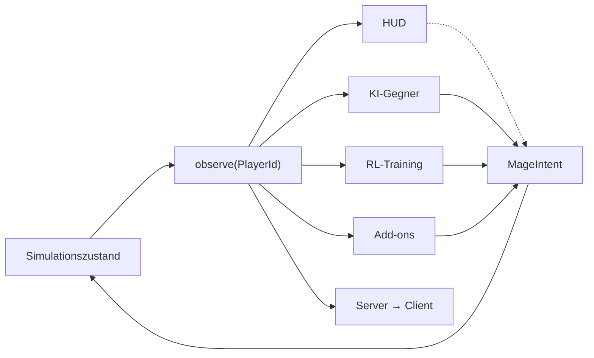

# Beobachtung — was ein Spieler, eine KI oder ein Add-on sehen darf

Eine **Beobachtung** (`Observation`) ist alles, was ein Spieler in einem Tick wissen kann. Sie ist die einzige Leseschnittstelle für HUD, KI-Gegner, RL-Training, Add-ons und den Netzwerk-Versand. Geschrieben wird nur über `MageIntent`. Entschieden in [[adr-0019-eine-beobachtungs-schnittstelle|ADR-0019]] (vorgeschlagen).

## Inhalt

| Teil | Inhalt |
| --- | --- |
| Kopf | Tick-Nummer, `PlayerId`, `TeamId`, Version des Formats |
| Ich | Position, Richtung, Leben, Mana, effektive [[attribute\|Attribute]], aktive Effekte mit Restdauer, Cooldowns je Slot, tot oder lebendig |
| Sichtbare Magier | für jeden mit gesetztem Team-Bit in `VisibleTo`: `SimId`, `PlayerId`, `TeamId`, Position und Geschwindigkeit, Leben als Anteil, sichtbare Effekte |
| Sichtbare Zauber | `SimId`, `SpellId`, Position, Richtung, Team des Zaubernden |
| Ereignisse | Treffer, Schaden, Tode des letzten Ticks, soweit wahrnehmbar |
| Arena | statisch, einmal pro Runde: Kollider-Beschreibung, Spawnpunkte |

## Regeln

- Erzeugt von **einer** Funktion in `mage_sim`; niemand sonst baut Beobachtungen.
- Nur Daten aus `VisibleTo` des eigenen Teams; was das Team nicht sieht, kommt nicht vor, auch nicht als „unbekannt“-Eintrag, der verrät, dass es existiert.
- Positionen als Weltkoordinaten; Varianten relativ zum Spieler (für RL) werden in der RL-Brücke abgeleitet, nicht in der Simulation.
- serde-serialisierbar, versioniert, mit expliziten Enum-Diskriminanten ([[p-004-enum-diskriminanten-stabilitaet-fuer-netcode|P-004]]).
- Kostet etwas: Wer keine Beobachtung braucht (ein reiner Simulationslauf), erzeugt keine.

## Was offen ist

- Wie viel von gegnerischen Attributen sichtbar ist (genaue Werte oder nur Anteile): Spieldesign, siehe [[attribute|Attribute]].
- Ein kompaktes Binärformat für RL (Tensoren fester Größe) entsteht in der RL-Brücke ([[p-013-rl-bruecke|P-013]]).
