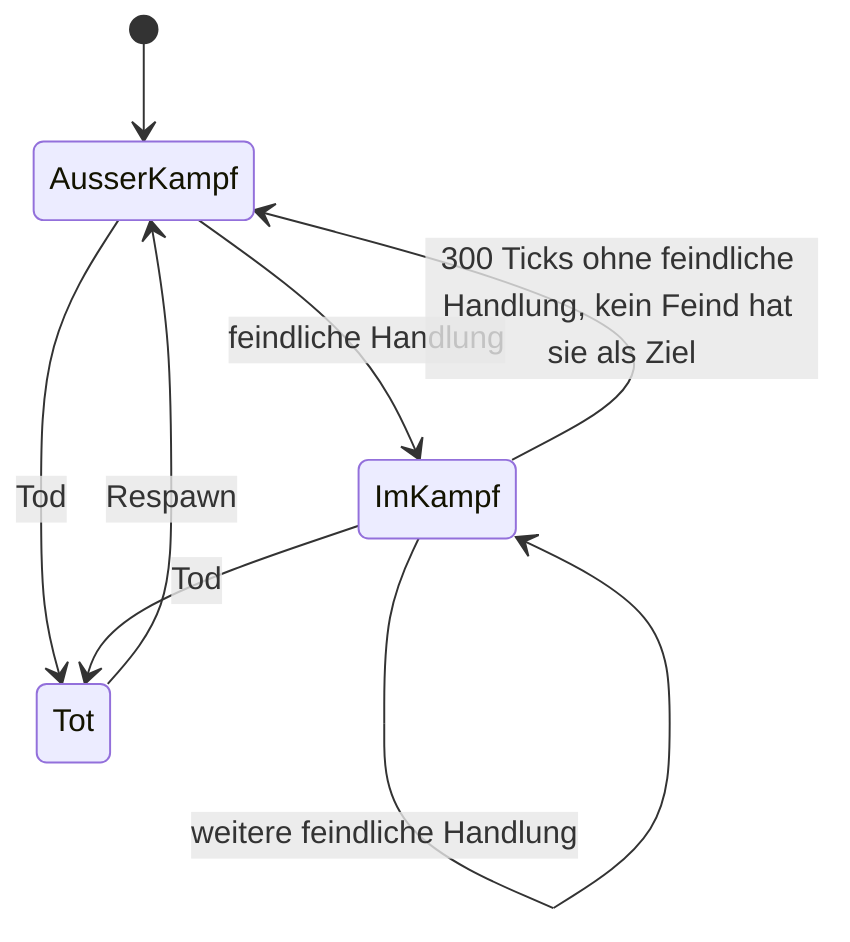

# Einheiten — Magier, Kreaturen, Reittiere und Bosse auf einem gemeinsamen Kern

Alles, was kämpfen kann, ist eine **Einheit**: Magier, wilde Tiere, Pets, Reittiere, Bosse. Grundsatz: [[adr-0031-einheiten-magier-und-kreaturen|ADR-0031]]; Kampfzustand: [[adr-0032-kampfzustand|ADR-0032]].

## Kern und Zusätze

| Teil | Components | haben |
| --- | --- | --- |
| Kern | `SimId`, `TeamId`, Leben, `BaseAttributes` und Modifikatoren, `Loadout`, `CombatState`, Kollider, `Controller` | alle Einheiten |
| Magier | `Mage`, `Controller::Player(PlayerId)` | Spielerfiguren |
| Kreatur | `Creature(CreatureId)` aus einem `CreatureBlueprint`, meist `Controller::Ai(BehaviorId)` | Tiere, Gegner, Bosse, Pets, Reittiere |
| Pet | `Owner(SimId)`; folgt dem Besitzer, kämpft für dessen Team | Kreaturen |
| Reittier | `Rideable { seats }`, `Rider(SimId)` solange jemand aufsitzt | Kreaturen |
| Boss | `BossPhases` (Phasenwechsel bei Lebensanteil, als Daten), mehrere Trefferzonen | Kreaturen |

## Reittiere mit eigenem Leben

Ein Reittier ist eine Kreatur mit `Rideable` ([[reittiere|Reittiere]]). Sitzt ein Magier auf, steuert sein Intent das Reittier; der Magier wird ans Reittier gebunden und bewegt sich mit ihm. Treffer treffen, wen der Shape-Cast zuerst berührt: Reittier oder Reiter. Stirbt das Reittier, wird der Reiter abgeworfen (im Flug: Sinkflug zum Boden). Ein eigenes Reittier ist ein Pet des Magiers und kommt nach dem Tod mit Abklingzeit zurück.

## Kampfzustand

| Zustand | Charakter ändern (Leiste, Ausrüstung) | Aufsitzen |
| --- | --- | --- |
| außer Kampf | ja, sofort | ja |
| im Kampf | nein | nein (Vorschlag) |
| tot | ja, wirkt ab Respawn | nein |

## Was offen ist

- [[p-022-feindschaft-zwischen-teams|P-022]]: Wer wem feind ist, wenn es wilde Tiere, neutrale Kreaturen und Pets gibt.
- [[p-023-boss-mechaniken|P-023]]: Phasen, Trefferzonen und besondere Fähigkeiten von Bossen als Daten.
- [[p-020-faehigkeitenleiste-aendern|P-020]]: Welche Fähigkeiten und Ausrüstung erlaubt sind.
