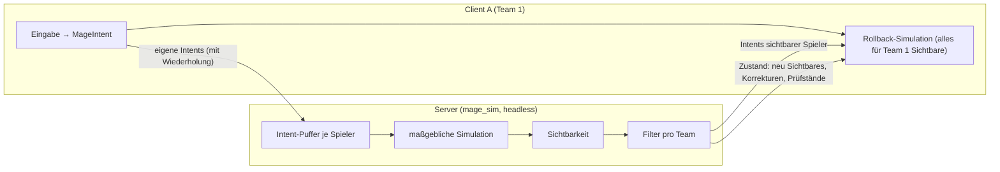

# Netzwerk — Rollback, wo immer möglich; der Server ist Schiedsrichter

> [!info] Stand
> Geplant für Milestone 7, nichts davon ist gebaut. Grundsatz: [[adr-0017-rollback-mit-server-als-schiedsrichter|ADR-0017]] (angenommen). Sicherheit: [[sicherheit|Sicherheit]].

## Die Idee in drei Sätzen

Jeder Client simuliert alles, was sein Team sehen darf, selbst, mit Rollback: eigene Eingaben wirken sofort, fremde werden vorhergesagt und bei Abweichung durch Zurückspulen korrigiert. Der Server leitet dafür die Intents sichtbarer Spieler weiter und führt nebenher die maßgebliche Simulation. Wo Rollback nicht reicht, weil Information fehlt (Unsichtbares) oder Plattformen abweichen, schickt der Server Zustand, und der gilt.

## Ablauf

- **Verbindungen:** alle Clients zum Server, nicht untereinander (direkte Verbindungen innerhalb eines Teams sind als spätere Optimierung offen: [[p-016-direkte-verbindungen-zwischen-clients|P-016]]). Server dediziert (`mage_server`, headless) oder als Host in einem Spiel-Client für private Runden.
- **Tickrate:** 60 Ticks pro Sekunde überall.
- **Client → Server:** `MageIntent` mit Tick-Nummer; jedes Paket wiederholt die letzten Intents, damit Verluste nichts kosten.
- **Server → Client, laufend:** die Intents aller Spieler, die das Team des Clients in diesem Tick sieht, sobald sie beim Server angekommen sind. Jeder weitergeleitete Intent trägt Absender (`PlayerId`), Tick und Sequenznummer und ist unabhängig vom Transportweg; pro Tick und Spieler zählt der erste, Doppelte werden verworfen.
- **Rollback auf dem Client:** Der Client rechnet voraus. Für fremde Spieler, deren Intent noch fehlt, gilt deren letzter Intent weiter (gehaltene Knöpfe und Achsen, keine neuen Drücke). Kommt der echte Intent und weicht ab, spult der Client zum betroffenen Tick zurück (Snapshot) und rechnet bis jetzt neu. Rollback-Fenster: höchstens 8 Ticks (Platzhalter, abhängig von der Rechenleistung, [[benchmarks|Benchmarks]]).
- **Server → Client, bei Bedarf:**
  - **Neu sichtbar:** Wird ein Gegner für ein Team sichtbar, schickt der Server dessen Zustand für diesen Tick; der Client fügt ihn per Rollback ein.
  - **Wirkung aus dem Verborgenen:** Was unsichtbare Gegner an Sichtbarem verändern (Treffer, Zusammenstöße), kann der Client nicht vorhersagen; der Server schickt den betroffenen Zustand.
  - **Prüfstand:** Regelmäßig (Platzhalter alle 30 Ticks) eine Prüfsumme über den sichtbaren Zustand eines bestätigten Ticks; bei Abweichung den vollen sichtbaren Zustand.
- **Im Zweifel der Server:** Bei jeder Abweichung spult der Client zum Tick des Server-Stands zurück, übernimmt ihn und rechnet seine eigenen Intents neu.
- **Zu späte Eingaben:** Liegt ein weitergeleiteter Intent weiter zurück als das Rollback-Fenster, verwirft der Client ihn und wartet auf Zustand vom Server.
- **Uhrabgleich:** Der Client läuft dem Server um die halbe Paketlaufzeit plus einen kleinen Puffer voraus, damit seine Intents rechtzeitig ankommen; ein Regelkreis passt das laufend an.

## Was wo Rollback kostet

| Lage | Verhalten |
| --- | --- |
| alle Beteiligten sichtbar, gleiche Plattform | reiner Rollback, Server bestätigt nur |
| ein Gegner wird unsichtbar | der Server leitet seine Intents nicht mehr weiter; der Client sieht ihn nicht mehr |
| ein unsichtbarer Gegner trifft | Korrektur durch Server-Zustand; der Treffer erscheint mit einer Paketlaufzeit Verzögerung |
| Clients auf verschiedenen Plattformen | gelegentliche kleine Abweichungen, durch Prüfstände korrigiert ([[p-003-cross-plattform-determinismus-fuer-echtes-pvp\|P-003]]) |
| langsamer Rechner | kleineres Rollback-Fenster, dadurch mehr Korrekturen vom Server |

## Protokoll

- Nachrichten sind serde-Typen mit kompakter Binärkodierung, Protokollversion im Handshake, expliziten Enum-Diskriminanten ([[p-004-enum-diskriminanten-stabilitaet-fuer-netcode|P-004]]).
- Auf dem Draht nur stabile IDs (`PlayerId`, `TeamId`, `SpellId`, `SimId`), nie `Entity`.
- Transport: verschlüsselt, UDP-basiert auf Desktop und Mobile, WebTransport oder WebSocket im Browser ([[p-009-netzwerk-crate-und-transport|P-009]]).

## Replays und Zuschauer

Ein Replay ist Szenario plus Seed plus alle Intents aller Spieler; der Server zeichnet es auf. Weil die Simulation deterministisch ist, spielt es sich auf derselben Plattform exakt nach. Zuschauer und Replays sehen alles, deshalb bekommen Zuschauer laufender Runden die Intents mit Verzögerung.

## Was offen ist

- [[p-009-netzwerk-crate-und-transport|P-009]] Netzwerk-Crate und Transport (eine fertige Rollback-Crate muss Teilsicht und Server-Korrekturen erlauben)
- [[p-015-trefferwertung-unter-latenz|P-015]] Trefferwertung unter Latenz
- [[p-016-direkte-verbindungen-zwischen-clients|P-016]] Direkte Verbindungen zwischen Clients als Optimierung
- [[p-003-cross-plattform-determinismus-fuer-echtes-pvp|P-003]] Abweichungen zwischen Plattformen
- Lobby, Matchmaking und Konten: nach Milestone 7.

Getestet wird das Ganze mit simulierten Leitungen: [[synchronisation-latenz|Synchronisation & Latenz]].
