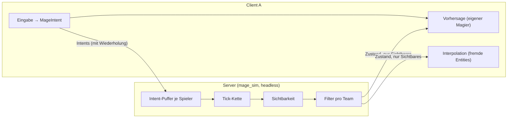

# Netzwerk — ein Server entscheidet, Clients sagen voraus

> [!info] Stand
> Geplant für Milestone 7, nichts davon ist gebaut. Grundsatz: [[adr-0017-server-autoritativ-mit-client-vorhersage|ADR-0017]] (vorgeschlagen). Sicherheit: [[sicherheit|Sicherheit]].

## Aufbau

- **Server:** führt die einzige maßgebliche Simulation mit derselben Crate `mage_sim` wie der Client. Dediziert (headless, eigener Prozess `mage_server`) oder als Host in einem Spiel-Client für private Runden. Kein Peer-to-Peer.
- **Tickrate:** 60 Ticks pro Sekunde auf dem Server. Zustand an Clients 20 bis 30 Mal pro Sekunde (Platzhalter), als Delta gegen den letzten bestätigten Stand.
- **Vom Client zum Server:** nur `MageIntent` mit Tick-Nummer. Jedes Paket wiederholt die letzten Intents, damit einzelne verlorene Pakete nichts kosten. Der Server puffert kurz (Jitter-Puffer); fehlt ein Intent, gilt der letzte gehaltene Zustand weiter, aber kein neuer Tastendruck.
- **Vom Server zum Client:** Zustand nur der Entities, die das Team des Clients sieht ([[sichtbarkeit|Sichtbarkeit]]), plus die eigenen Ereignisse.
- **Vorhersage:** Der Client simuliert seinen eigenen Magier sofort mit seinen Intents. Kommt ein Server-Stand, vergleicht er; weicht er ab, setzt er auf den Server-Stand zurück und simuliert seine noch nicht bestätigten Intents neu (Reconciliation). Dafür werden die Snapshot- und Restore-Funktionen aus [[erweiterungspunkte|Erweiterungspunkte]] gebraucht.
- **Fremde Magier und Zauber** werden zwischen zwei Server-Ständen interpoliert, mit etwa 100 ms Puffer (Platzhalter).
- **Uhrabgleich:** Der Client läuft dem Server um die halbe Paketlaufzeit plus Puffer voraus, damit seine Intents rechtzeitig ankommen; ein kleiner Regelkreis passt das laufend an.
- **Prüfsummen:** Server und Client berechnen für bestätigte Ticks eine Prüfsumme über den sichtbaren Zustand des eigenen Magiers. Abweichungen werden geloggt und in Tests gezählt.

## Protokoll

- Nachrichten sind serde-Typen mit kompakter Binärkodierung, einer Protokollversion im Handshake und expliziten Enum-Diskriminanten ([[p-004-enum-diskriminanten-stabilitaet-fuer-netcode|P-004]]).
- Auf dem Draht nur stabile IDs (`PlayerId`, `TeamId`, `SpellId`, `SimId`), nie `Entity`.
- Transport: verschlüsselt, UDP-basiert auf Desktop und Mobile, WebTransport oder WebSocket im Browser. Welche Crate: [[p-009-netzwerk-crate-und-transport|P-009]].

## Replays und Zuschauer

Ein Replay ist Szenario plus Seed plus alle Intents aller Spieler; der Server zeichnet es auf. Weil die Simulation deterministisch ist, spielt es sich auf derselben Plattform exakt nach. Zuschauer und Replays sehen alles (kein Sichtbarkeitsfilter), deshalb bekommen Zuschauer laufender Runden den Zustand mit Verzögerung.

## Was offen ist

- [[p-009-netzwerk-crate-und-transport|P-009]] Netzwerk-Crate und Transport
- [[p-015-trefferwertung-unter-latenz|P-015]] Trefferwertung unter Latenz
- [[p-003-cross-plattform-determinismus-fuer-echtes-pvp|P-003]] Abweichungen der Vorhersage zwischen Plattformen
- Lobby, Matchmaking und Konten: nach Milestone 7.

Getestet wird das Ganze mit simulierten Leitungen: [[synchronisation-latenz|Synchronisation & Latenz]].
