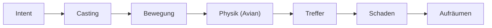

# Simulationsmodell — die eine große Wette: eine deterministische Tick-Kette

**Invarianten (nicht verhandelbar):**

1. Der gesamte Gameplay-Zustand liegt in Components und Ressourcen. Nichts in `Local<>`, in System-Closures oder in Präsentations-Entities.
2. Die Simulation schreitet nur im `FixedUpdate` fort, in einer explizit geordneten Kette von `SystemSet`s: Intent → Casting → Bewegung → Physik → Treffer → Schaden → Aufräumen. Nichts hängt an impliziter Systemreihenfolge; Avians Physik wird ausdrücklich in `FixedUpdate` eingehängt und als Set Physik in diese Kette eingeordnet ([[p-005-avians-physik-in-fixedupdate-einhaengen|P-005]]).
3. Cooldowns, Fuse-, Status- und Lebensdauern werden in fixen Ticks gezählt. Simulationscode liest niemals echte oder virtuelle Frame-Zeit.
4. Zufall kommt ausschließlich aus einer einzigen geseedeten RNG-Ressource.
5. Spieler und Zauber-Blueprints werden über stabile IDs identifiziert (`PlayerId`, `SpellId`), niemals über `Entity`, in allen Daten, die über ein Netzwerk gingen oder gespeichert würden. Jede Simulations-Entity trägt zusätzlich eine `SimId`: ein fortlaufender Zähler, beim Spawn vergeben, Teil des Snapshots.
6. Simulations-Entities tragen keine Meshes, Materialien, Lichter oder UI. Visuals entstehen, indem die Präsentation auf Marker-Components reagiert.
7. Die Simulations-Plugins laufen headless, ohne Fenster und ohne Renderer.
8. Schaden, Mana-Verbrauch und Tod laufen jeweils durch exakt einen Codepfad: Schaden durch den `DamageApplied`-Handler, Tod durch den `MageDied`-Handler, Mana-Verbrauch durch das Casting-System.
9. Determinismus: gleicher Startzustand, gleiche Intent-Sequenz und gleicher Seed ergeben auf derselben Plattform- und Compiler-Konfiguration einen bit-identischen Endzustand. Wo Ergebnisse von Iterationsreihenfolge abhängen, wird nach `SimId` sortiert, niemals nach Entity-Index, weil Entities nach einem Rollback-Restore neue Indizes bekommen ([[adr-0013-simid-statt-entity-index-fuer-jede|ADR-0013]]).

**Die Kette und was jedes Set tut:**

| Set | Verantwortung |
| --- | --- |
| Intent | Für jeden Magier den Intent dieses Ticks in eine `IntentForTick`-Component einfrieren: `pressed` aus den Latch-Zählern des `InputBuffer` ableiten, `just_released` aus dem Vor-Tick-Zustand, Latches zurücksetzen. Bei einer Rollback-Neuberechnung liest dieses Set stattdessen aus der Intent-Historie und fasst den Puffer nicht an |
| Casting | Cooldown-Ticks dekrementieren, Mana regenerieren (vor allen Ausgaben desselben Ticks), Cast-Anforderungen prüfen (Flanke, Mana, Cooldown), Mana abziehen, Cooldown setzen, Zauber aus dem Blueprint spawnen und on-cast-Modifikatoren anwenden (Spread) |
| Bewegung | Intent auf kinematische Magier-Bewegung abbilden (Aufruf von Avians `MoveAndSlide`), danach per-Tick-Modifikatoren (Homing inklusive LOS-Raycast gegen die statischen Arena-Kollider), danach Projektile entlang ihrer Segmente bewegen und Fuses herunterzählen |
| Physik | Avian-Schritt: überträgt die neuen Positionen der kinematischen Magier-Kollider in die Spatial-Query-Struktur, damit das Set Treffer gegen den Stand dieses Ticks castet. Es gibt keine dynamischen Körper, der Solver hat nichts zu lösen |
| Treffer | Shape-Casts über die Travel-Segmente des Ticks auswerten, abgelaufene Fuses feststellen; jeder Impact wird nur gesammelt (`PendingImpacts`), noch nichts wird angewendet |
| Schaden | Gesammelte Impacts nach `SimId` des Zaubers sortieren und in dieser Reihenfolge `SpellImpact` auslösen; die Observer-Kette `SpellImpact` → Effekte → `DamageApplied` → HP → `MageDied` läuft vollständig in diesem Set ([[adr-0014-impacts-sammeln-dann-sortiert-ausloesen|ADR-0014]]). Statuseffekte (Slow) klingen pro Tick ab |
| Aufräumen | getroffene und abgelaufene Zauber despawnen, Respawn-Timer toter Magier fortschreiben und Respawn ausführen |

Projektile sind **keine** Physik-Körper: Sie werden im Set Bewegung bewegt und im Set Treffer per Shape-Cast geprüft, daher kann die Rollback-Schicht später den kompletten simulationsrelevanten Zustand in eigenen Components snapshotten, ohne Physikinterna zu berühren ([[adr-0003-kinematik-statt-dynamischer-rigidbodies|ADR-0003]]).
