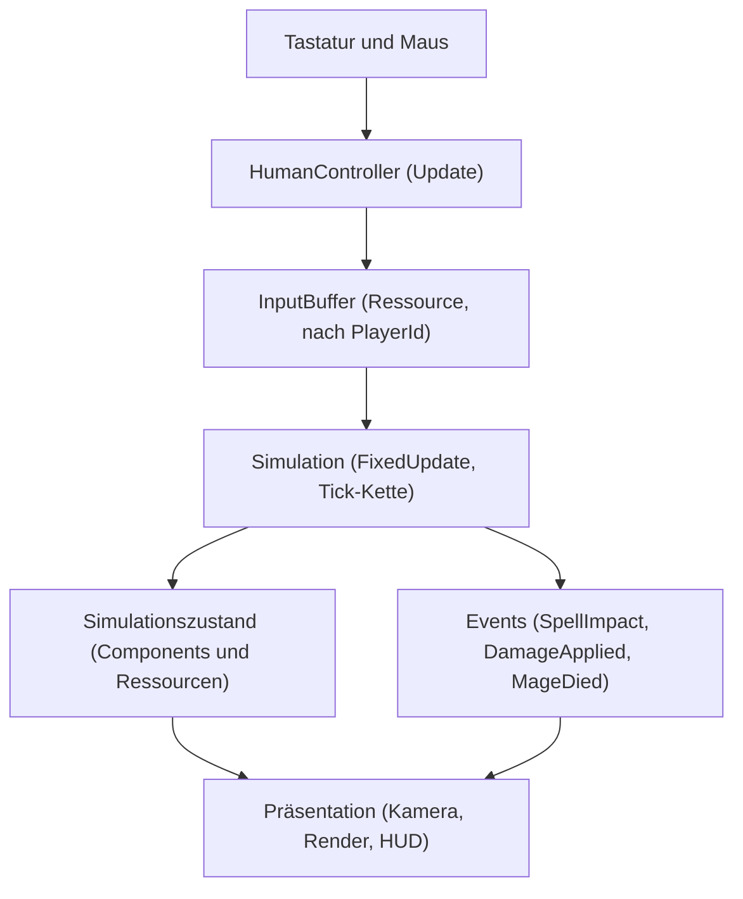

# Übersicht — das System in einem Diagramm

Alles Gameplay läuft in einer headless-fähigen Simulation im `FixedUpdate`. Die Präsentation ist ein reiner Beobachter: Sie erzeugt aus Eingabe und Kamera den `MageIntent` und hängt Visuals an Simulations-Entities, sobald deren Marker-Components auftauchen.

Zwei Regeln halten das System erweiterbar: Die Simulation kennt niemanden, der Intent erzeugt (Mensch, KI, Netzwerk sind austauschbar), und die Präsentation schreibt genau eine Sache zurück: den Intent.
