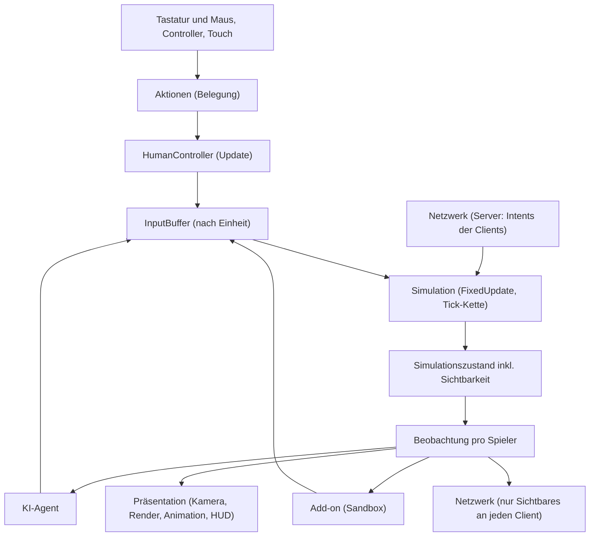

# Übersicht — das System in einem Diagramm

Alles Gameplay läuft in einer headless-fähigen Simulation im `FixedUpdate` (Crate `mage_sim`). Wer einen Magier steuert, ist der Simulation egal: Mensch, KI, Add-on oder Netzwerk liefern denselben `MageIntent`. Wer etwas über die Welt erfährt, bekommt eine gefilterte [[beobachtung|Beobachtung]]; was ein Team nicht sieht, erfährt es nicht.

Drei Regeln halten das System erweiterbar:

1. Die Simulation kennt niemanden, der Intent erzeugt; Mensch, KI, Add-on und Netzwerk sind austauschbar.
2. Die Präsentation schreibt genau eine Sache zurück: den Intent. Animationen, Texte und Eingabegeräte gibt es nur dort.
3. Gelesen wird über die Beobachtung, mit Sichtbarkeitsfilter; niemand bekommt einen Sonderzugang zur Welt.

Mehr: [[projektstruktur|Projektstruktur]], [[simulationsmodell|Simulationsmodell]], [[netzwerk|Netzwerk]], [[sicherheit|Sicherheit]], [[plattformen|Plattformen]].
