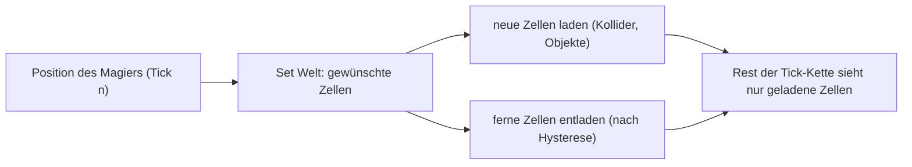

# Welt — eine große Welt in Zellen, geladen wird nur der Interessenbereich

Neben der Arena gibt es eine große, zusammenhängende Welt mit potenziell tausenden Spielern. Grundsatz: [[adr-0028-grosse-welt-mit-interessenbereich|ADR-0028]]. Die Arena ist eine kleine Welt, die immer ganz geladen ist; alles hier gilt für beide.

## Zellen und Interessenbereich

| Begriff | Bedeutung | Platzhalter |
| --- | --- | --- |
| Zelle | Quadrat des Weltrasters mit statischen Kollidern, Spawnpunkten, Weltobjekten; adressiert durch `CellId` (x, z als ganze Zahlen) | 64 m |
| Interessenradius R | Zellen, deren Mittelpunkt näher als R am Magier liegt, sind für diesen Spieler geladen | 160 m |
| Hysterese Δ | entladen wird erst ab R + Δ | 32 m |
| Fernsicht | grobe Landschaft außerhalb von R, nur Präsentation | bis 2 km |

## Regeln

- **Simulation:** Ein Set *Welt* am Anfang der Tick-Kette (vor Intent) berechnet aus den Positionen die nötigen Zellen. Auf dem Client sind das die Zellen des eigenen Interessenbereichs, auf dem Server alle Zellen, in denen sich ein Spieler aufhält. Zellen-Daten kommen über eine Schnittstelle, die auf dem Client lädt und auf dem Server aus der Weltdatei liest; die Simulation liest keine Dateien selbst ([[plattformen|Plattformen]]).
- **Nichts außerhalb:** Was außerhalb des Interessenbereichs liegt, gibt es auf dem Client nicht, auch nicht als „unbekannt“-Eintrag ([[beobachtung|Beobachtung]]). Ein Zauber, der den Bereich verlässt, verschwindet für diesen Client; der Server rechnet ihn weiter.
- **Fernsicht:** grobes Gelände (Höhenkarte in niedriger Auflösung), große Silhouetten, Himmel. Liegt ausschließlich im Client, wird beim Bewegen in Stufen nachgeladen (mehrere Detailstufen), trägt keine Kollider und keine Entities der Simulation.
- **Netzwerk:** Der Server schickt einem Client beim Laden einer Zelle den Zustand aller sichtbaren Entities darin und leitet ab dann deren Intents weiter; beim Entladen hört er auf ([[netzwerk|Netzwerk]]).
- **Leistung:** R ist eine Einstellung mit Ober- und Untergrenze, die der Server festlegt; schwache Geräte bekommen ein kleineres R nur für die Fernsicht, nicht für das Spiel selbst, damit niemand durch ein größeres R einen Vorteil hat.

## Was offen ist

- [[p-017-welt-auf-mehrere-server-verteilen|P-017]]: Wie die Welt auf mehrere Serverprozesse verteilt wird.
- [[p-018-sichtbarkeit-bei-vielen-teams|P-018]]: Sichtbarkeit pro Team skaliert nicht auf eine offene Welt mit vielen Gruppen.
- [[p-021-weltdaten-und-fernsicht|P-021]]: Format der Weltdaten und Detailstufen der Fernsicht.
