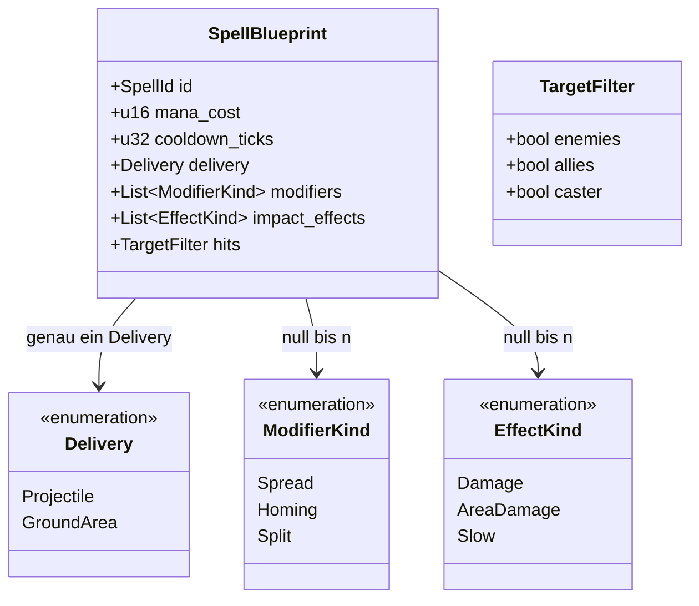

# Zauber-Datenmodell — Blueprints, Deliveries, Modifikatoren, Effekte

Ein Blueprint ist serialisierbare Daten in einer Registry-Ressource, `SpellId` als Schlüssel: Manakosten, Cooldown in Ticks, genau ein Delivery, Modifikatoren, on-Impact-Effekte.

**Deliveries:** `Projectile` fliegt mit fixer Geschwindigkeit pro Tick und prüft jeden Tick per Shape-Cast entlang des Wegs; nach Ablauf seiner Lebensdauer in Ticks verfällt es ohne Impact. `GroundArea` wirkt an einem Bodenpunkt: Zielpunkt ist der Schnittpunkt des Zielstrahls mit Boden oder Hindernis, geklemmt auf eine maximale Reichweite (Platzhalter 30 m); ohne Treffer liegt der Punkt auf maximaler Reichweite entlang `aim_dir`. Am Zielpunkt entsteht eine Markierung mit einer Fuse in fixen Ticks (Platzhalter 20); das Fuse-Ende zählt als Impact. Die Präsentation kann die Fuse als fallenden Feuerball rendern.

**Modifikatoren** sind Components an der gespawnten Zauber-Entity, jeder mit einem eigenen System, und haken in genau einen Lifecycle-Punkt:

| Modifikator | Lifecycle | Verhalten |
| --- | --- | --- |
| `Spread` | on cast | Streut die Zielrichtung mit dem geseedeten RNG (Platzhalter ±2°), bevor Startrichtung bzw. Zielpunkt daraus berechnet werden. Ist der RNG-Verbraucher, der den Determinismustest mit Leben füllt. |
| `Homing` | per tick | Dreht die Flugrichtung mit begrenzter Drehrate Richtung Ziel: der nächste Gegner (anderes Team), der für das Team des Zaubernden sichtbar ist ([[sichtbarkeit|Sichtbarkeit]]), bei gleichem Abstand die kleinere `SimId`. Ohne Sichtlinie oder wenn das Ziel unsichtbar wird, entfällt das Ziel, der Bolt fliegt gerade weiter. Der LOS-Raycast gegen die Arena-Kollider läuft im selben System im Set Bewegung. Damit hat die LOS-Anforderung einen echten Verbraucher. |
| `Split` | on impact | Spawnt beim Impact N Fragment-Projektile (Platzhalter 4; eigener Blueprint `Fragment` in der Registry). Die Fragmente starten 0,5 m entlang der Impact-Normale versetzt und fliegen in festen, gleichmäßig verteilten Richtungen parallel zur getroffenen Fläche; sie existieren ab dem Folgetick. Bewusst on impact statt on expire, damit die Fragmente am Trefferpunkt entstehen ([[adr-0012-split-hakt-auf-on-impact|ADR-0012]]). |

**Effekte** sind reine Daten, angewendet im einzigen Impact-Pfad: `Damage` (direkt), `AreaDamage` (Radius um den Impact, Platzhalter 4 m), `Slow` (Bewegungsreduktion 50 % für 90 Ticks). `AreaDamage` trifft jeden Magier im Radius, auch den Zaubernden (wen genau, legt der Zielfilter der Fähigkeit fest, siehe unten), sofern ein LOS-Raycast vom Impact-Punkt zum Magier frei ist: Hindernisse schirmen ab. Slow fügt einen Attribut-Modifikator auf Bewegungstempo hinzu (−50 %, 90 Ticks), kein Effekt-Callback ([[attribute|Attribute]]); ein erneuter Slow derselben Quelle stapelt nicht, sondern setzt die Restdauer zurück.

**Die Drei-Zauber-Matrix** (Werte sind Balance-Platzhalter, zentral in einer Ressource):

| Spell | Delivery | Modifikatoren | on-Impact-Effekte | Zielfilter | Mana | Cooldown |
| --- | --- | --- | --- | --- | --- | --- |
| Bolt | Projectile | Spread | Damage | Gegner (fliegt durch Verbündete) | 10 | 30 Ticks |
| Homing-Bolt | Projectile | Homing | Damage, Slow | Gegner (fliegt durch Verbündete) | 20 | 60 Ticks |
| Feuerball | GroundArea | Split, Spread | AreaDamage | alle, auch Verbündete und der Zaubernde | 35 | 120 Ticks |
| Fragment (entsteht nur durch Split) | Projectile, Lebensdauer 30 Ticks | keine | Damage | alle, auch Verbündete und der Zaubernde | 0 | 0 |

Geteilt wie gefordert: der Modifikator `Spread` (Bolt, Feuerball) und der Effekt `Damage` (Bolt, Homing-Bolt, Fragment).

**Zielfilter pro Fähigkeit** ([[adr-0027-zielfilter-pro-faehigkeit|ADR-0027]]): Jeder Blueprint legt fest, wen er trifft: Gegner, Verbündete, den Zaubernden selbst, in beliebiger Kombination. Der Filter gilt für die Trefferprüfung (ein Projektil, das Verbündete nicht trifft, fliegt durch sie hindurch) und für alle Effekte des Blueprints; ein einzelner Effekt kann ihn enger fassen (etwa ein späterer Heilzauber: Schaden an Gegner, Heilung an Verbündete). Hindernisse blockieren unabhängig vom Filter. Die Werte in der Tabelle sind Platzhalter für die Balance; Fragmente erben den Filter nicht automatisch, sie haben ihren eigenen Blueprint.

**Trennung von Konfiguration, Casting und Ausführung:** Der Blueprint ist Daten; das Casting-System liest Blueprint und Intent-Flanken und spawnt Laufzeit-Entities; Laufzeitsysteme lesen niemals die Eingabe des Zaubernden. Neue Deliveries, Modifikatoren und Effekte sind neue Enum-Varianten plus je ein System, kein Eingriff in bestehende (siehe Erweiterungspunkte).
