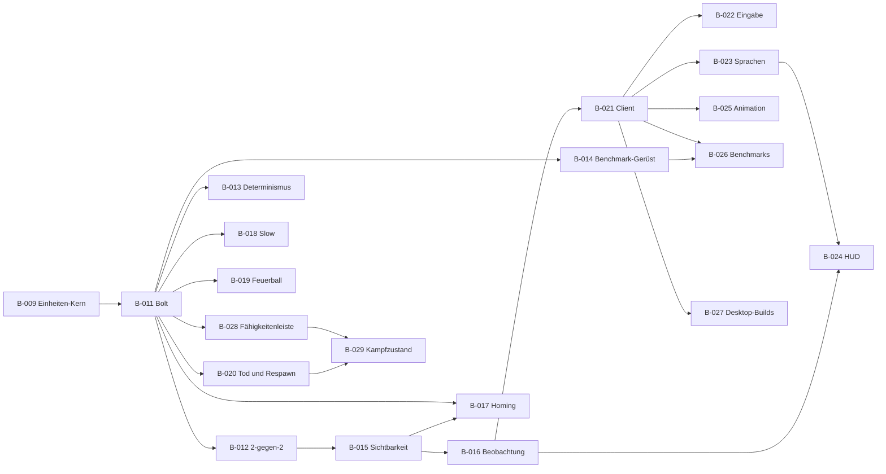

# Backlog — die nächsten Aufgaben der Implementierung

Die konkreten nächsten Aufgaben, mit Abhängigkeiten. Was dahinter steht, erklären die verlinkten Seiten; die große Linie steht in [[roadmap|Roadmap & Milestones]].

> [!important] So wird ein Item abgearbeitet (Menschen und Agenten; die einzige Fassung dieses Ablaufs)
> 1. **Aufgabe wählen:** das oberste Item mit Status *offen*, dessen Abhängigkeiten alle erledigt sind. Ein Item ist *blockiert*, solange eine Entscheidung (ADR) oder ein Problem (P) in seiner Spalte *Abhängig von* offen ist; baut es auf einer *vorgeschlagenen* ADR auf ([[entscheidungen|Entscheidungen]]), erst Daniel fragen.
> 2. **Tests zuerst** ([[adr-0026-tests-zuerst|ADR-0026]]): die Tests aus der Spalte *Tests* schreiben, laufen lassen, fehlschlagen sehen; dann implementieren, bis sie grün sind; dann aufräumen. Tests nie abschwächen, um Code durchzubringen; ist ein Test falsch, begründen und Vault nachziehen. Noch nicht erfüllbare Tests: `#[ignore = "B-nnn"]`.
> 3. **Fertig heißt:** die Gates aus `AGENTS.md` grün, betroffene Vault-Seiten nachgezogen.
> 4. **Dieses Backlog pflegen:** das erledigte Item **entfernen** und mit einem Satz ins Implementation-Log des Milestones schreiben (`milestones/mN-implementation-log.md`); Items, die sich durch die Arbeit geändert haben, **anpassen**; neu entdeckte Aufgaben **als neue Items** mit Abhängigkeiten und Tests eintragen; Graph unten nachziehen.
> 5. **Übergabe schreiben:** [[status|Status]] überschreiben: was erledigt wurde, die nächste Aufgabe, welche Seiten sie braucht, Hinweise. Das ist das Letzte jeder Sitzung; die nächste liest zuerst nur diese Seite.
> 6. **Nummern** werden nie wiederverwendet. Nächste freie Nummer: **B-030**.

## Milestone 1 — Walking Skeleton

| Nr. | Aufgabe | Abhängig von | Tests (zuerst schreiben) | Status |
| --- | --- | --- | --- | --- |
| B-009 | Einheiten-Kern: Leben, Mana in Tausendsteln, Regeneration, Cooldowns, Bewegung per `MoveAndSlide` mit effektivem Tempo; für alle Einheiten, nicht nur Magier ([[einheiten\|Einheiten]]) ([[kampf-physik\|Kampf & Physik]]) | — | Regeneration vor Ausgaben; Cooldown N = frühestens N Ticks später; Tempo-Modifikator ändert Weg pro Tick | offen |
| B-011 | Bolt: Blueprint-Registry mit Zielfilter ([[adr-0027-zielfilter-pro-faehigkeit\|ADR-0027]]), Projectile, Spread, Damage, Impacts sammeln und sortiert auslösen, `DamageApplied` ([[zauber-datenmodell\|Zauber-Datenmodell]]) | B-009 | Spec-Test: Dummy verliert Leben, Zaubernder Mana; Cast wirkt im Tick der Eingabe ohne jede Präsentation | offen |
| B-012 | 2-gegen-2 und Zielfilter | B-011 | Bolt fliegt durch einen Verbündeten und trifft den Gegner dahinter; ein Blueprint mit Filter „alle“ trifft den Verbündeten; Filter „Zaubernder“ trifft nur den Zaubernden | offen |
| B-013 | Snapshot-Serialisierung und Determinismustest ([[determinismustest\|Determinismustest]]) | B-011 | zwei Läufe, byte-gleich; Test schlägt fehl, wenn eine Reihenfolge an `Entity` hängt | offen |
| B-014 | Benchmark-Gerüst mit `duel_idle` und `duel_combat` ([[benchmarks\|Benchmarks]]) | B-011 | Benchmarks laufen in CI in Kurzform | offen |

## Milestone 2 — Zauber-Matrix

| Nr. | Aufgabe | Abhängig von | Tests (zuerst schreiben) | Status |
| --- | --- | --- | --- | --- |
| B-015 | Set Sichtbarkeit, Grundform: Sichtweite und Sichtlinie, noch ohne Tarnung ([[sichtbarkeit\|Sichtbarkeit]]) | B-012 | Gegner hinter Wand nicht sichtbar; eigenes Team immer sichtbar | offen |
| B-016 | Beobachtung, Grundform: Ich, sichtbare Magier und Zauber ([[beobachtung\|Beobachtung]]) | B-015 | keine Entity ohne Team-Bit in der Beobachtung | offen |
| B-017 | Homing-Bolt mit Zielwahl nach Team und Sichtbarkeit | B-011, B-015 | nächster sichtbarer Gegner; Zielverlust hinter Wand; Gleichstand nach `SimId` | offen |
| B-018 | Slow als Attribut-Modifikator | B-011 | Tempo sinkt ab dem Folgetick; erneuter Slow setzt Dauer zurück | offen |
| B-019 | Feuerball: GroundArea, Fuse, Split, Fragmente, AreaDamage | B-011 | Zielpunkt geklemmt; Fuse in Ticks; Fragmente ab Folgetick; Hindernis schirmt Flächenschaden ab; Flächenschaden trifft auch Verbündete und den Zaubernden (Zielfilter) | offen |
| B-029 | Kampfzustand: `CombatState` (außer Kampf, im Kampf, tot), Eintritt im Set Schaden, Austritt nach 300 Ticks im Set Aufräumen; Charakter-Änderung als geprüfter Befehl ([[einheiten\|Einheiten]]) | B-020, B-028, [[adr-0032-kampfzustand\|ADR-0032]] | Schaden setzt beide Seiten in den Kampf; 299 Ticks ohne Handlung noch im Kampf, 300 außer Kampf; Leiste ändern im Kampf abgelehnt, außer Kampf und im Tod angenommen | offen |
| B-028 | Fähigkeitenleiste: `Loadout` pro Spieler im Szenario, Prüfung (erlaubt, höchstens `MAX_SLOTS`, keine doppelt), Casting liest Slot → `SpellId` aus der Leiste ([[faehigkeiten\|Fähigkeiten & Belegung]]) | B-011, [[adr-0030-faehigkeitenleiste-vom-spieler\|ADR-0030]] | ungültige Leiste wird abgelehnt; zwei Spieler mit vertauschten Leisten zaubern bei gleichem Slot verschiedene Zauber; leerer Slot wirkt nichts | offen |
| B-020 | Tod und Respawn mit Spawnpunkten je Team | B-011 | tödlicher Treffer setzt `Dead` im selben Tick; Respawn nach 180 Ticks am Team-Spawnpunkt | offen |

## Milestone 3 — Arena & Präsentation

| Nr. | Aufgabe | Abhängig von | Tests (zuerst schreiben) | Status |
| --- | --- | --- | --- | --- |
| B-021 | Client-Grundgerüst: Greybox-Arena, Low-Res-Target, Interpolation, Teamfarben ([[arena-praesentation\|Arena & Präsentation]]) | B-016 | Client-App startet ohne Fenster im Test; Visuals erscheinen an Marker-Entities | offen |
| B-022 | Eingabe über Aktionen (Tastatur/Maus, Controller), Kamera und `aim_dir`; Crate-Frage ([[eingabegeraete\|Eingabegeräte]], [[p-011-eingabe-crate-und-zielhilfe\|P-011]]) | B-021 | gleiche Aktion von Tastatur und Controller ergibt gleichen Intent; Umbelegung wirkt | offen |
| B-023 | Lokalisierung Englisch und Deutsch; Integrationsfrage ([[lokalisierung\|Lokalisierung]], [[p-012-fluent-integration\|P-012]]) | B-021 | jeder Schlüssel in jeder Sprache; jeder verwendete Schlüssel definiert | offen |
| B-024 | HUD aus der Beobachtung | B-016, B-023 | HUD zeigt nur Beobachtungsdaten; deutscher Text läuft nicht über | offen |
| B-025 | Animation entkoppelt (prozedural an der Greybox) ([[adr-0021-animation-ist-reine-praesentation\|ADR-0021]]) | B-021 | Cast wirkt im selben Tick, ob Animation läuft oder nicht; Animation bricht bei neuem Cast ab | offen |

## Milestone 4 — Härtung & Messung

| Nr. | Aufgabe | Abhängig von | Tests (zuerst schreiben) | Status |
| --- | --- | --- | --- | --- |
| B-026 | Benchmarks vollständig, Bildzeit-Modus im Client, Referenzrechner festlegen ([[benchmarks\|Benchmarks]], [[p-008-mindest-hardware-und-leistungsbudget\|P-008]]) | B-014, B-021 | alle Szenarien messbar; Budgets eingetragen | offen |
| B-027 | Desktop-Builds für Windows, Linux, macOS in CI ([[p-014-mobile-und-web-builds\|P-014]]) | B-021 | Artefakte für alle drei Systeme | offen |

## Später (wird zu Items, wenn der Milestone näher rückt)

| Milestone | Abhängig von | Seite |
| --- | --- | --- |
| M5 Unsichtbarkeit | M2 (Sichtbarkeit Grundform), M3 | [[sichtbarkeit\|Sichtbarkeit]] |
| M6 KI & Reinforcement Learning | M2 (Beobachtung), M4 (Benchmarks) | [[ki-und-rl\|KI & RL]] |
| M7 Netzwerk & Sicherheit | M4, M5 (Interest Management braucht volle Sichtbarkeit) | [[netzwerk\|Netzwerk]], [[sicherheit\|Sicherheit]] |
| M8 Add-ons | M6 (gleiche Schnittstelle), M7 (Regeln im PvP) | [[add-ons\|Add-ons]] |
| M9 Mobile & Web | M3 (Eingabe über Aktionen), M4 | [[plattformen\|Plattformen]] |
| M10 Reittiere | M3, M12 (Reittiere sind Kreaturen), B-028, B-029 | [[reittiere\|Reittiere]] |
| M12 Kreaturen | M6 (KI), [[adr-0031-einheiten-magier-und-kreaturen\|ADR-0031]] | [[einheiten\|Einheiten]] |
| M11 Große Welt | M7 (Server, Interest Management), P-017, P-018, P-021 | [[welt\|Welt]] |

## Abhängigkeiten

